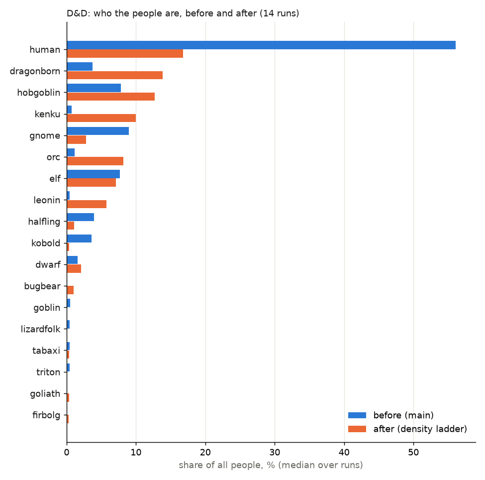
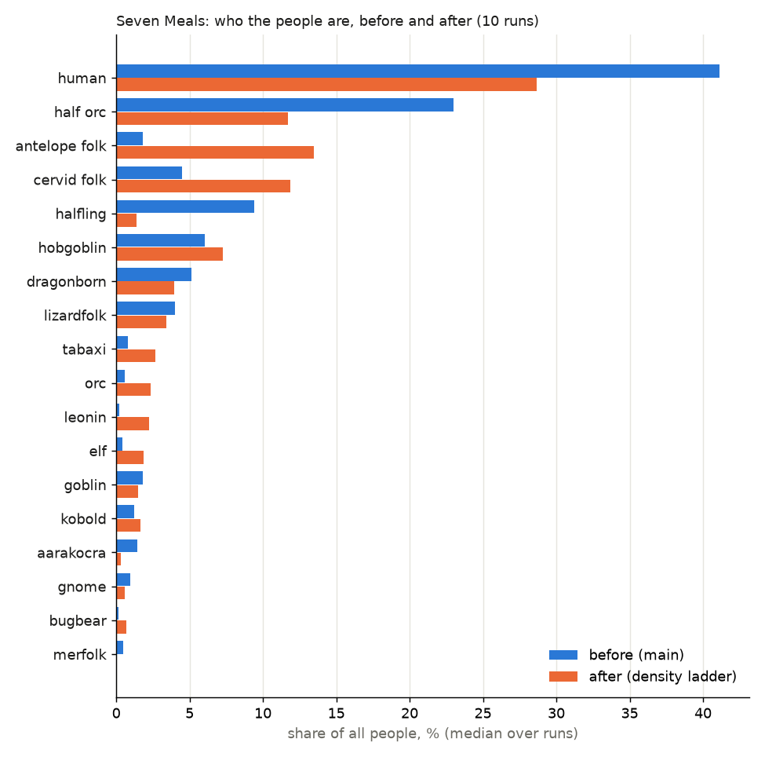
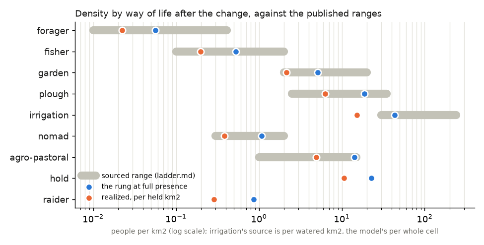

# The density ladder, built (PW-1275 step 2): results

Lane 136 built it, lane 137 measured it (2026-11-02). Before = main (fc4e0398), after = this branch; the same 48 runs of
`tools/peoples_robust.py` each (families base, jitter, subset, knob; worlds 4360a3 and af2677; seeds 7, 10, 13).

## In plain words

- **Humans no longer swamp the map.** In the D&D preset humans fall from about 56% of all people to about 17% (median over 14 runs);
  the commonest people of a run now holds 27% (was 56%), and every D&D run is under half. Humans fall because other kinds now farm
  at the same density beside them: dragonborn, hobgoblins, orcs, kenku and leonin all rise several-fold. Seven Meals moves the same
  way, less (humans 41% to 29%).
- **There are many more people: 2.3-2.6x.** D&D runs hold about 1.0 billion (was 0.46), Seven Meals 1.9 (was 0.7). The sourced plough
  rung at the medieval-to-renaissance stage (25, up to 35 per km2) and the irrigation rung are denser than the old human 10-12, and
  now every farming kind gets them, not only humans. This is what the sources say; it is also the biggest change you will see.
- **The densities sit inside the published ranges.** Every way of life, at full presence, lands inside ladder.md's range (chart
  below). Measured over the land itself, cells hold ~0.9x the ladder's number (plough-led cells 14.4 people/km2 against 16.1).
- **Q1 A works, but one number shown is misleading** (you asked to be warned): each people's own "density" in the workbench reads
  ~0.4x its rung, because a cell is shared by about two peoples and the number counts the whole cell as each one's. The land is
  not under-filled. I did not calibrate (dividing by 0.4 would pack every shared cell at ~2x the sourced numbers); a draft asks to
  show "people per km2 it fills" instead.
- **Things that look odd, stated plainly:**
  1. Hunting kinds farm: tabaxi, leonin, goliaths, bugbears learn crops as fast as any farmer (their low leaning to farm cancels out
     in the test), so most of their people end up ploughing or gardening. Draft for your decision (lean: a delay, not a cap).
  2. Irrigation lifts gardeners without a plough a lot: kenku 0.7% to 10%, with two thirds of kenku living on irrigated cells; elves
     and gnomes half. Egypt's numbers (Butzer) are for plough farmers; the ruling (Q5 A) did not tie irrigation to the plough.
  3. Den peoples and halflings fall: kobolds 3.6% to 0.4%, goblins 0.5% to 0.1%, halflings 4% to 1% (Seven Meals 9% to 1.4%, and
     they lead no cells); gnomes 9% to 3%. Halflings and gnomes were flat 12/km2 before; now they farm at the shared rung on land
     they share with humans. Troglodytes die out in every D&D run, before and after.
  4. Small patches now fade: the viable-population check removed no patch before (forager floor 0.3); now it removes hundreds a run
     for the sparse peoples (aarakocra, lizardfolk, antelope-folk, cervid-folk), but their ranges hold (area before/after within
     ~10%), except tortles (D&D 4.3 to 2.6 Mkm2).
  5. Tabaxi depend on the world: 7-14% of people on world 4360a3, nearly absent on af2677 (as before the change: leonin take that
     role there). The D&D median (0.4%) hides that.

## Before / after tables

Medians over the paired base + jitter runs. "Island fades" = small patches removed by the viable-population check (median per run).

### D&D (14 runs)

| people | share before | after | cells led before | after | area Mkm2 before | after | extinct before | after | fades before | after |
|---|---|---|---|---|---|---|---|---|---|---|
| human | 56.1% | 16.8% | 39.3% | 11.1% | 70.8 | 38.6 | 0/14 | 0/14 | 0 | 0 |
| dragonborn | 3.7% | 13.9% | 8.5% | 13.2% | 17.7 | 26.8 | 0/14 | 0/14 | 0 | 82 |
| hobgoblin | 7.8% | 12.7% | 7.7% | 7.5% | 19.8 | 19.3 | 0/14 | 0/14 | 0 | 8 |
| kenku | 0.7% | 10.0% | 2.6% | 9.6% | 22.7 | 20.1 | 0/14 | 0/14 | 0 | 42 |
| orc | 1.2% | 8.2% | 2.2% | 6.8% | 16.9 | 15.4 | 0/14 | 0/14 | 0 | 54 |
| elf | 7.7% | 7.1% | 8.5% | 8.1% | 20.7 | 19.9 | 0/14 | 0/14 | 0 | 0 |
| leonin | 0.5% | 5.8% | 0.1% | 1.9% | 13.8 | 13.6 | 0/14 | 0/14 | 0 | 184 |
| gnome | 9.0% | 2.8% | 5.2% | 4.7% | 8.5 | 11.4 | 0/14 | 0/14 | 0 | 0 |
| dwarf | 1.6% | 2.1% | 1.3% | 1.4% | 2.1 | 2.4 | 0/14 | 0/14 | 0 | 0 |
| halfling | 4.0% | 1.1% | 1.2% | 0.0% | 3.4 | 2.5 | 0/14 | 0/14 | 0 | 0 |
| bugbear | 0.1% | 1.0% | 0.0% | 1.5% | 5.3 | 6.4 | 0/14 | 0/14 | 0 | 56 |
| kobold | 3.6% | 0.4% | 5.5% | 5.0% | 8.7 | 10.8 | 0/14 | 0/14 | 0 | 0 |
| tabaxi | 0.4% | 0.4% | 0.3% | 0.4% | 13.1 | 1.1 | 0/14 | 0/14 | 0 | 14 |
| goliath | 0.0% | 0.4% | 0.2% | 1.0% | 1.6 | 2.3 | 0/14 | 0/14 | 0 | 9 |
| firbolg | 0.0% | 0.3% | 0.2% | 0.4% | 1.0 | 2.0 | 0/14 | 0/14 | 0 | 0 |
| drow | 0.0% | 0.2% | 0.1% | 0.2% | 0.5 | 0.5 | 0/14 | 0/14 | 0 | 0 |
| goblin | 0.5% | 0.1% | 0.4% | 0.0% | 4.1 | 4.0 | 0/14 | 0/14 | 0 | 214 |
| lizardfolk | 0.5% | 0.1% | 3.2% | 3.5% | 15.6 | 16.1 | 0/14 | 0/14 | 0 | 213 |
| aarakocra | 0.2% | 0.1% | 2.2% | 4.0% | 10.5 | 13.6 | 0/14 | 0/14 | 0 | 130 |
| triton | 0.4% | 0.1% | 0.7% | 0.3% | 3.4 | 3.4 | 0/14 | 0/14 | 0 | 0 |
| tortle | 0.1% | 0.1% | 0.1% | 0.0% | 4.3 | 2.6 | 0/14 | 0/14 | 0 | 70 |
| sea_elf | 0.1% | 0.0% | 0.1% | 0.1% | 1.1 | 1.2 | 0/14 | 0/14 | 0 | 0 |
| troglodyte | 0.0% | 0.0% | 0.0% | 0.0% | 0.0 | 0.0 | 14/14 | 14/14 | 0 | 102 |

Total people (median) 457 M -> 1032 M; commonest people's share 56% -> 27%.

### Seven Meals (10 runs)

| people | share before | after | cells led before | after | area before | after | extinct before | after | fades before | after |
|---|---|---|---|---|---|---|---|---|---|---|
| human | 41.1% | 28.6% | 32.1% | 26.7% | 72.1 | 59.8 | 0/10 | 0/10 | 0 | 0 |
| antelope_folk | 1.8% | 13.5% | 3.7% | 11.1% | 34.3 | 33.4 | 0/10 | 0/10 | 0 | 919 |
| cervid_folk | 4.5% | 11.9% | 7.6% | 11.1% | 32.3 | 34.7 | 0/10 | 0/10 | 0 | 365 |
| half_orc | 23.0% | 11.7% | 12.6% | 3.5% | 40.6 | 41.0 | 3/10 | 2/10 | 0 | 0 |
| hobgoblin | 6.0% | 7.3% | 2.4% | 1.0% | 25.0 | 27.1 | 0/10 | 0/10 | 0 | 16 |
| dragonborn | 5.1% | 4.0% | 3.7% | 2.4% | 13.0 | 14.1 | 0/10 | 0/10 | 0 | 87 |
| lizardfolk | 4.0% | 3.4% | 10.4% | 11.9% | 49.2 | 51.3 | 0/10 | 0/10 | 0 | 819 |
| tabaxi | 0.8% | 2.7% | 0.2% | 2.2% | 7.8 | 9.8 | 0/10 | 0/10 | 0 | 68 |
| orc | 0.6% | 2.4% | 0.8% | 1.7% | 6.0 | 10.6 | 0/10 | 0/10 | 0 | 7 |
| leonin | 0.2% | 2.2% | 0.0% | 0.0% | 8.0 | 8.5 | 0/10 | 0/10 | 0 | 162 |
| elf | 0.4% | 1.9% | 0.4% | 2.1% | 7.9 | 6.8 | 0/10 | 0/10 | 0 | 0 |
| kobold | 1.2% | 1.7% | 2.4% | 10.2% | 4.9 | 19.9 | 0/10 | 0/10 | 0 | 244 |
| goblin | 1.8% | 1.5% | 1.8% | 1.9% | 5.9 | 5.9 | 0/10 | 0/10 | 0 | 36 |
| halfling | 9.4% | 1.4% | 2.9% | 0.0% | 15.9 | 4.1 | 0/10 | 0/10 | 0 | 44 |
| bugbear | 0.1% | 0.7% | 0.0% | 0.0% | 4.3 | 3.6 | 0/10 | 0/10 | 0 | 150 |
| gnome | 0.9% | 0.6% | 2.3% | 1.6% | 5.3 | 3.7 | 0/10 | 0/10 | 0 | 0 |
| aarakocra | 1.4% | 0.3% | 10.3% | 5.9% | 45.2 | 42.6 | 0/10 | 0/10 | 0 | 1442 |
| dwarf | 0.2% | 0.2% | 0.4% | 0.2% | 0.7 | 0.8 | 0/10 | 0/10 | 0 | 23 |
| (merfolk, deep_folk, tortle, goliath) | 0.0-0.5% | 0.0-0.1% | | | | | 0 | 0 | | |

Total people (median) 712 M -> 1873 M; commonest share 41% -> 29%.

### The suite's invariants (all 48 runs)

| | before | after |
|---|---|---|
| runs with any fail | 7 | 6 |
| a people extinct (authored) | 3 (half_orc, Seven Meals) | 2 (half_orc) |
| one people over 85% | 4 (all dnd3, the 3-people tree) | 4 (the same) |
| crashes | 0 | 0 |
| commonest share, median over all tries | 48% | 29% |
| tries with 5+ peoples at or under 70% | 86% | 100% |

(Troglodytes die out in every D&D run before and after; the report does not count them as authored extinctions.)

### Ways of life by people, after (D&D: share of each people's people on each rung, median over runs)

| people | forager | fisher | garden | plough | irrigation | nomad | agro-pastoral | hold | raider |
|---|---|---|---|---|---|---|---|---|---|
| human | - | - | - | 68% | 24% | - | 12% | - | - |
| dragonborn | - | - | - | 46% | 27% | 1% | 14% | - | - |
| hobgoblin | - | - | - | 57% | 20% | 1% | 13% | - | - |
| kenku | - | - | 7% | 12% | 66% | - | 3% | - | - |
| orc | - | - | - | 64% | 15% | - | 14% | - | - |
| elf | - | - | 9% | 17% | 51% | - | 13% | - | - |
| leonin | - | - | - | 47% | 10% | 1% | 13% | - | - |
| gnome | - | - | 33% | - | 56% | - | - | - | - |
| dwarf | - | - | - | - | - | - | - | 100% | - |
| halfling | - | - | - | 58% | 7% | - | 4% | - | - |
| bugbear | - | - | - | 19% | 16% | - | 2% | - | - |
| tabaxi | - | - | - | 45% | 12% | - | - | - | - |
| goliath | - | - | 83% | - | - | - | 2% | - | - |
| kobold | 30% | 51% | - | - | - | - | - | - | 18% |
| drow | - | - | 81% | - | 10% | - | - | - | - |
| aarakocra, triton, tortle, sea elves, lizardfolk | 2-17% | 83-98% | - | - | - | - | - | - | - |
| goblin | - | - | - | - | - | 42% | - | - | 57% |

(Medians per column, so rows need not sum to 100%. "Irrigation" is a cell's main rung when its watered part feeds more people than
its rain-fed part.)

### Density by rung against ladder.md (after; all D&D and Seven Meals runs pooled)

| rung | realized, per km2 a people is present on | the rung at full presence | sourced range (ladder.md) | land itself, cells led on this rung (dnd s7, 4360a3) |
|---|---|---|---|---|
| forager | 0.023 | 0.056 | 0.01-0.41 | 0.059 (rung 0.079) |
| fisher | 0.20 | 0.53 | 0.1-2 | 0.32 (0.48) |
| garden | 2.2 | 5.1 | 2-20 | 3.2 (4.4) |
| plough | 6.3 | 18.7 | 2.5-35 | 14.4 (16.1) |
| irrigation | 15 | 44 (per whole cell) | 30-240 per watered km2 | 33 (33) |
| nomad | 0.38 | 1.1 | 0.3-2 | 1.2 (1.1) |
| agro-pastoral | 4.9 | 14.1 | 1-15 | 8.2 (8.8) |
| hold | 10.7 | 22.7 | its valleys' rung | 22 (29) |
| raider | 0.29 | 0.86 | - | - |

## The four checks

**(a) Q1 A against presence: define the rung as "per km2 the people fills"; no calibration.** A people's mean presence on its cells is
0.34-0.47 on every rung, so its own realized density is ~0.4x the rung. But the presences in a peopled cell sum to 0.83 on average
(median 0.79, 10-90%: 0.42-1.22; 1.9 peoples a cell; probe `fill_probe.py` here, dnd seed 7, 4360a3), and the land holds 0.90x the
presence-weighted rung (8.7 against 9.6 people/km2 of peopled land). So the gap is cell-sharing, not missing people: the ladder's
regional means (Binford, England, PNG are people over a region's land) are met by the land. Dividing by the mean presence would put
~2x the sourced density on every shared cell. What is wrong is only the per-people number shown (`h.dens`, the workbench, the suite's
`density`): draft `draft-ladder-density-per-filled-land.md`.

**(b) Forager rung 0.036 at NPP 330: correct, not a slip.** Rerunning `binford_by_npp.py` on the D-PLACE files: the terrestrial fit
(fishing < 30%, n=171) is log10 d = -4.620 + 1.259 log10 NPP, 0.036 at NPP 330; Binford's terrestrial societies at NPP 300-450 have
median 0.033 (mean 0.071, n=48). The whole-sample median 0.11 and upper quartile 0.34 are higher because Binford's foragers mostly
live on richer land (63 of 171 terrestrial societies at NPP > 600, median 0.16 there) and include fishers, who have their own rung
here. The model's land NPP is on the same scale (4360a3: median 350, mean 331; af2677 median 199). The old 0.3 was the upper
quartile used as a typical value. Kept; power 1.3 kept (fit 1.26).

**(c) Irrigation and fishing thresholds: kept.** On 4360a3 (af2677 alike): river flow >= 5 on 13.7% of land cells, but the watered
share (0 at flow 5 rising to 0.3 of a cell at flow 200) averages 1.4% of land and 1.9% of farmable land: a thin floodplain, as Q5 A
asks (ladder.md: the numbers are per watered km2; Butzer's shaduf added 10-15% of arable in Egypt, the most irrigated country).
Irrigated cells hold ~20-25% of farming peoples (humans 24%), because a watered km2 feeds ~10x a rain-fed one at the late stages.
Fishing: fish good > 0.2 on 31% of land, the fisher rung beats foraging on 27%; where it exists its median is 0.33 /km2 against
Binford's fishing-led median 0.25 and sedentary median 0.41. Sea and coast peoples (tritons, tortles, sea elves, aarakocra) live
83-98% as fishers. The oddity is not the thresholds but irrigation for gardeners (warning 2 above).

**(d) Hunting kinds farming: the rule is applied as ruled, but "knowing" is too easy.** A people takes up a crop when the crop is
known on a fifth of its land (`crops.Crops.step`: adopt = share x propensity >= 0.2 x propensity, so the propensity, 0.1 for hunters,
cancels), and crops spread over any peopled land at ~1 km/yr (`animals.Stock._front`). So once farmers' crops reach them, tabaxi,
leonin, goliaths and bugbears farm all their farmable land: in D&D 45-58% of tabaxi and leonin people plough, 83% of goliaths garden.
Draft `draft-hunters-learn-crops-regardless.md` (needs-decision; lean: delay knowing by ~1/propensity, keep Q2 A's land rule).

## Lane 136's six warnings

1. Q1 A and presence: resolved, see (a); the shown per-people number is drafted.
2. Irrigation labelled on any riverside cell: fixed by lane 136 (flow 5-200), checked in (c): 1.4% of land watered.
3. Fishers on any fish: fixed by lane 136 (> 0.2), checked in (c).
4. Forager rung 8x below the old 0.3: correct per (b); small-island fades appear (hundreds of patches a run) but ranges hold except
   tortles (4.3 -> 2.6 Mkm2 in D&D).
5. Human lactase lost with the herder groups: open, draft `draft-human-lactase-without-herder-groups.md`.
6. goblin_world's lost densities: open, draft `draft-goblin-world-densities.md`.

## Tests

Full `pytest -q -m "not slow"`: 937 passed, 1 skipped (two thread tests re-run alone after the first pass ran with one numba thread).
No goldens changed; no bounds loosened (lane 136's test rewrites replace the removed groups and density numbers with the ladder's).
Removed: the dead `prey.people_fields` and its constants.

Scripts: `compare_suites.py` here (tables and charts from two snapshot folders); `binford_by_npp.py` (lane 130).

---

# Lane 136's build notes (kept for the record)

## What is built (commit on this branch)

- `planet/lineages/ladder.py` (new): the shared ladder. Per line, per cell: density = kind x sum over its ways of life of
  (share living that way there) x (that rung there). Rungs and numbers are in its docstring and `TABLE` (sources: `ladder.md`):
  forager 0.036 at NPP 330, power 1.3 (Binford fit; Q3 C); fisher 1.2 x the fish good above 0.2; garden 5; plough 8 / 14 / 25 by
  stage, at most 35 a cell (Q7 A); irrigation 30 -> 240 per watered km2 on the floodplain share only (Q5 A); nomad 0.8 at grazing NPP
  263; agro-pastoral = a cell both farmed and herded; dwarven hold = valleys' farming x trade (cap 0.5 of food, placeholder) + 0.1
  mushrooms (Q6 A); den peoples forager x kind 1.2 / (1 - raid share), raid share capped at 0.3, half-cap at 5 farmers+herders /km2
  within 2 rings (Q4 A), farming at 0.1 weight.
- Who lives which way (Q2 A): cultivation known (a crop taken up) -> the fertile good / 0.5 of a cell farms; herding known (a herd
  animal) -> grazing land outside the fields herds; the rest forages or fishes. Tech stages inside the history are proxies (the tech
  tree runs after the history): plough stage from the time since a plough animal (iron +3.2 kyr, medieval +5.3, the tree's Earth dates),
  irrigation 3.5 kyr after cultivation, holds' terraces 6.5 kyr after cultivation; capped by meta.era.
- Spec: per-people `density` / `band_km2` are gone (parse raises with a pointer); `kind` (0.5-2, default 1) replaces it. dnd: goblin,
  kobold, troglodyte 1.2 (troglodytes get `denning`); tabaxi, leonin 0.8. DEMOGRAPHY trait densities removed.
- PW-1357: dnd groups removed (human farmer/herder/nomad/seafarer/arctic, steppe/forest orc, hill dwarf), their wishes and uses; the
  orc pair kept as a note in the dnd header for Seven Meals. City minorities (city goblins/kobolds) kept: they are not a way of life
  (judgement, ask Daniel). Seven Meals keeps its groups (only its densities removed).
- PW-1351: halfling way farmer, gnome horticulturalist, dwarf farmer; crops no longer exclude `subterranean` (holds and dens may farm).
- History: `model.py` builds `self.kx` (kind x band nudge) and `self.ladder`; `growth.py` refreshes the ladder each step (era dens and
  ERA_DENSITY removed); `dens[k]` is now the line's mean over held land (Q1 A). Land use per cell reads the ladder's farm/herd shares
  (`landuse.frame_inputs`); saved demography carries the realized density (landuse.derive, demes, techtree read it).
- Viewer: Peoples workbench shows "kind x" and "rung · /km2" (main rung, mean density; hover: its rungs and the whole ladder);
  results column likewise; schema gains `ladder` and `kind_range` (`run.py`).
- `tools/peoples_robust.py`: knob family moves the kind factor; per people it records `density` (people / held km2) and `ways`
  {rung: [people, held km2, people at full presence]}.
- Tests: obsolete density tests rewritten (`test_people_density_reads_the_ladder`); no-world tests set `h.dens` where they need a
  number (no world means no ladder). Lineage, peoples, niche and zoom-peoples tests pass (152); full `pytest -q -m "not slow"` not yet run.

## First look (one dnd run, seed 7, world 4360a3, before the fish/water fixes)

human 26%, hobgoblin 16%, kenku 11%, orc 9.5%, dragonborn 8.5%, halfling 8.3%, tabaxi 7.9%, elf 6.9%, leonin 3.4%; dwarves 0.03% (they
could not farm: fixed since by dropping crops' `subterranean` exclusion), troglodytes extinct. Everyone who learns cultivation farms,
so the hunting kinds (tabaxi, leonin, goliath, bugbear) now garden or plough over much of their land.

## Weird things to check (and warn Daniel about)

1. **Q1 A and presence.** Population = presence x density x area, presence <= 1, so a line's realized mean is below its rung's number.
   The suite now records the rung at full presence per rung (`ways[r][2]`): realized / that = mean presence. If it is far from 1,
   either divide by it (a calibration constant) or tell Daniel the rung is "at full habitat".
2. Irrigation was labelled on any riverside cell (flow >= 1: half the land). Raised to flow 5-200 (~15% of land); check its share.
3. Fishers took every cell with any fish good; now only above 0.2. Check foragers vs fishers.
4. The forager rung (Binford median fit, 0.036) is ~8x below the old 0.3 (upper quartile, D20): non-farming peoples fall a lot; small
   islands may lose sparse peoples to the viable-population fade.
5. Lactase: the human herders' milk share went with the groups; humans have none now (draft).
6. goblin_world (authored stress tree) lost its 6 / 1.5 / 5 densities (kind defaults now).

## Running (scratch: /tmp/claude-1000/-data-personal-repos-procedural-world-generation/43861907-2d55-4b88-96fd-7cf556b60255/scratchpad/l136)

- Before: `base/` (git archive of main fc4e0398) -> `out_main/`, families base, jitter, subset, knob (48; 12 done earlier, plus
  some authored), `--jobs 2 --threads 1`, log `main_run2.log`.
- After: `branch/` (this branch's working tree as committed) -> `out_branch/`, same 48, `--jobs 2`, log `branch_run.log`.
- ~390 s a run, ~2.5 h each. Report: `tools/peoples_robust.py report --out DIR` from each snapshot dir, with
  `PLANET_DATA=/data/personal/repos/procedural-world-generation` and the worktree's `.venv/bin/python`.

## Next steps (lane 136; done by lane 137, results above)

1. When both suites end: species shares main vs branch (humans' share), ways of life by people (`ways`), density by rung vs ladder.md's
   ranges, extinctions / monopolies; PNG charts here (before/after shares; rung densities against the sourced bands); a short plain
   results page for Daniel at the top of this file.
2. Full `uv run pytest -q -m "not slow"`; goldens only if outputs changed on purpose (say why).
3. Inbox drafts to file (none written yet): Q1 presence calibration (if it stays); tech stages from the tech tree inside the history;
   lactase share for humans without herder groups; trade for holds (placeholder until trade exists); landuse.derive still uses static
   shares; city minorities as groups (ask Daniel); early-modern rung (already on the wishlist); raiding share unsourced as a number
   (sources below); goblin_world's lost densities.
4. Backfill refs on PW-1275 / PW-1350 / PW-1351 / PW-1357 (planet/lineages/ladder.py, this page).

## Raiding: the sources read (a subagent of this lane, 2026-11-02; quotes verified in the texts it opened)

No measured share of food from raiding was found; raiding is a top-up to a herding or foraging base.
- Opler 1941, *An Apache Life-Way* (U Chicago), p. 332 (Chiricahua): "For men, raiding approaches hunting in economic significance."
- *Encyclopedia of World Cultures* (Gale 2008), "Western Apache - Economy" (secondary): ~40% gathered plants, 35% meat, 25% horticulture;
  raided stock sits inside the meat share.
- Burckhardt 1831, *Notes on the Bedouins and Wahabys* vol. 1, pp. 71-72: herding alone does not cover the Aeneze's yearly costs; "war
  and plunder therefore become necessary".
- Khazanov 1994, *Nomads and the Outside World*, pp. 221-222: raids "an important supplementary means of livelihood", "too unreliable";
  p. 187: the Maasai raided agriculturalists, the Samburu (among pastoralists like themselves) could not; p. 155: raids among nomads only
  circulate livestock.
- Hendrickson, Mearns & Armon 1996, IDS Bulletin 27(3) (abstract only): Turkana raiding as livelihood-enhancing, turning predatory.
Cap 0.3 and half-cap 5 /km2 are judgements on these.
