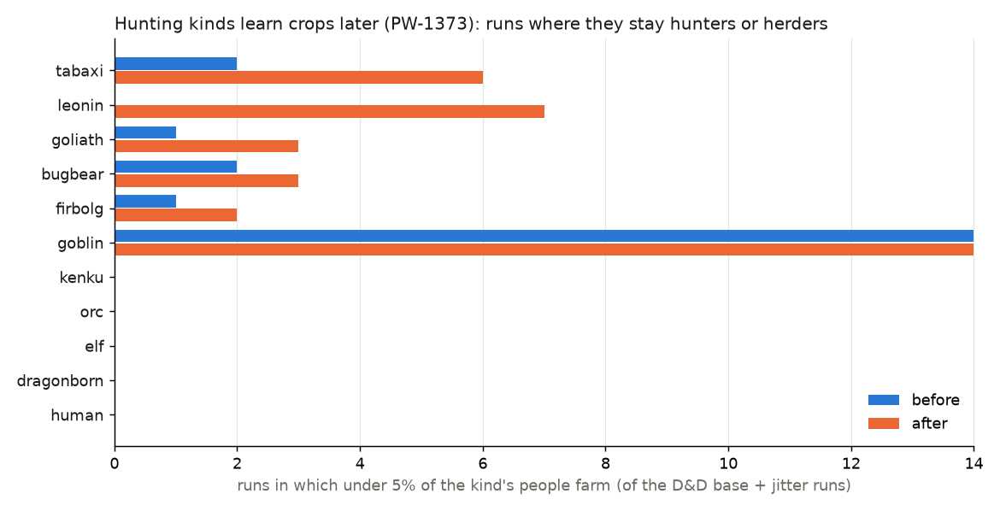

# Hunting kinds learn crops later (PW-1373 B), and the city minorities go (PW-1369 B)

Lane 139, 2026-11-02. Before = main (fc004dfc), after = this branch; the same 48 runs of `tools/peoples_robust.py` as lane 137
(families base, jitter, subset, knob; worlds 4360a3 and af2677; seeds 7, 10, 13). Tables from `hunters_lag.py` here (the D&D base +
jitter runs, 14 each).

## In plain words

- **What changed.** A people used to "know" a crop, and so farm all its farmable land, as soon as the crop had spread over a fifth of
  its land: its leaning to farm cancelled out of the test. Now the crop must have stood on a fifth of its land for a while first:
  0.4 thousand years divided by the people's leaning to farm. Farming kinds (leaning ~1) learn within ~400 years, which is at once on
  the history's scale; hunting kinds (leaning 0.1) take ~4,000 years, ten times slower. Once a people knows a crop, how much of its
  land it farms is still up to the land (your Q2 A ruling). The people that first cultivated a crop knows it at once.
- **Cat-folk lean to herds.** Kinds whose body says they eat only meat (tabaxi, leonin) take to crops at half their old leaning and to
  herd animals with +0.3; kinds that are carnivores but not strictly (bugbears; lizardfolk and tritons never farm anyway) get half
  that lean. Nothing forbids them crops: it only makes them slower to learn crops and keener on herds. For tabaxi that means crops in
  ~4,000 years instead of ~2,000, and a herd leaning of 0.4 instead of 0.1; leonin, already herders, now learn crops in ~8,000 years.
- **What it does.** The cat-folk now stay hunters or herders in about half the runs, and farm in the other half (when crops reach
  them early enough). Before, they farmed in almost every run:
  tabaxi stay non-farming in 6 of 14 D&D runs (was 2), leonin 7 of 14 (was 0), goliaths 3 (was 1), bugbears 3 (was 2), firbolgs 2 (was 1).
  Their share of all people falls: leonin 4.5% to 1.4%, tabaxi 0.6% to 0.3% (medians). Farming kinds hardly move (humans 19.6% to
  22.8%, the rest within a point).
- **10x kept, not 5x.** You asked for 5x if the slow kinds end up effectively never farming (under ~5% farming in nearly every run).
  At 10x they farm in about half the runs, so 10x stays. A check with twice the lag (0.8 thousand years) did make leonin never farm
  (6 of 6 screen runs) and tabaxi and goliaths mostly not (4 of 6): at that lag 5x would have been needed, and it would have landed
  where 10x at 0.4 is now. So the lag, not only the ratio, sets the outcome; 0.4 is anchored on Earth's Baltic and Scandinavian
  foragers, who lived beside the first farmers for ~1-1.5 thousand years before farming (Zvelebil & Rowley-Conwy 1984's
  "availability phase"), which is what a forager leaning of ~0.25 gives here.
- **One thing that looks odd.** In a run where the cat-folk do farm, nearly all their people live on farmed cells (a farmed cell holds
  ~100x a hunted one), so the pooled "share farming" in the table below stays near 90-99%; the change shows in how many runs they
  stay hunters (the chart), not in that column.
- **City goblins and kobolds are gone** (PW-1369 B), with the whole "minority in other peoples' cities" mechanism, which only they
  used. Town minorities wait for a towns model (inbox draft `draft-town-minorities-model.md`).

## Ways of life by kind (D&D base + jitter, 14 runs each)

"share" = median share of all people. Ways: the share of the kind's people on each way (a cell's people count on its main way),
pooled over the runs. "Farming" = garden + plough + irrigation + agro-pastoral + hold. Last column: runs where under 5% of the kind's
people farm.

| people | share before | after | forager b / a | herder b / a | plough b / a | irrigation b / a | farming b / a | runs < 5% farming b / a |
|---|---|---|---|---|---|---|---|---|
| human | 19.6% | 22.8% | - / - | - / - | 59% / 60% | 24% / 23% | 99% / 99% | 0 / 0 |
| dragonborn | 13.1% | 13.8% | - / - | 1% / 1% | 50% / 62% | 19% / 4% | 99% / 99% | 0 / 0 |
| hobgoblin | 10.9% | 11.7% | - / - | 1% / 1% | 57% / 55% | 20% / 21% | 99% / 99% | 1 / 1 |
| kenku | 9.7% | 9.7% | - / - | - / - | 31% / 39% | 55% / 46% | 100% / 100% | 0 / 0 |
| elf | 8.1% | 8.9% | - / - | - / - | 45% / 46% | 36% / 37% | 100% / 100% | 0 / 0 |
| orc | 7.5% | 8.3% | - / - | - / - | 63% / 72% | 14% / 5% | 100% / 99% | 0 / 0 |
| leonin | 4.5% | 1.4% | - / - | 1% / 10% | 54% / 65% | 14% / - | 99% / 90% | 0 / 7 |
| gnome | 2.9% | 3.0% | 1% / 1% | - / - | 14% / 14% | 50% / 50% | 99% / 99% | 0 / 0 |
| dwarf | 2.2% | 2.3% | - / - | - / - | - / - | - / - | 100% / 100% (hold) | 0 / 0 |
| halfling | 1.3% | 1.2% | - / - | 1% / 1% | 46% / 46% | 32% / 32% | 99% / 99% | 0 / 0 |
| bugbear | 1.0% | 1.1% | - / 1% | 1% / 1% | 44% / 44% | 32% / 33% | 99% / 99% | 2 / 3 |
| tabaxi | 0.6% | 0.3% | - / - | - / - | 54% / 72% | 35% / 18% | 100% / 99% | 2 / 6 |
| goliath | 0.3% | 0.2% | 1% / 3% | - / 2% | 32% / 16% | 9% / 2% | 98% / 96% | 1 / 3 |
| firbolg | 0.3% | 0.3% | 1% / 1% | - / 1% | 31% / 37% | 47% / 42% | 99% / 98% | 1 / 2 |
| kobold | 0.4% | 0.3% | 100% / 100% | - / - | - / - | - / - | - / - | 14 / 14 |
| goblin | 0.0% | 0.1% | 44% / 45% | 56% / 55% | - / - | - / - | - / - | 14 / 14 |
| drow | 0.2% | 0.2% | - / - | - / - | - / - | 21% / 20% | 100% / 100% (garden 80%) | 0 / 0 |
| aarakocra, triton, lizardfolk, tortle, sea elves | 0.0-0.1% | 0.0-0.1% | 100% (fishing and foraging) | | | | - | 14 / 14 |

(Agro-pastoral and garden columns are in the script's full output; they move little except goliaths, whose gardens rise 54% to 74%.)

## The suite's invariants (all 48 runs)

| | before | after |
|---|---|---|
| runs with any fail | 6 | 5 |
| crashes | 0 | 0 |
| a people extinct (authored) | 2 (half_orc, Seven Meals, never founded) | 1 (the same) |
| one people over 85% | 4 (all dnd3, the 3-people tree) | 4 (the same) |
| commonest share, median: dnd / Seven Meals / dnd5 | 25% / 29% / 57% | 26% / 30% / 58% |
| tries with 5+ peoples at or under 70% | 100% | 100% |

## Sizing PW-1385: farmed and herded people where the wild would feed nearly as many (owner 11-02)

Of each kind's farmed (or herded) people, the share on cells where its wild density there (the forager or fisher rung,
`Ladder.line`'s `wild`) is at least half the farm (herd) density it gets there. D&D base runs (6 before, 6 after), pooled; from
`tools/peoples_robust.py::wild_overlap`, table by `wild_overlap.py` here.

- **Farming: 0%, for every kind, in every biome, before and after** (kobolds 1%). Farm rungs are 5-35 people/km2 (gardens to
  plough, more with irrigation) against a forager rung of 0.01-0.4 and a fisher rung of at most ~1.2, so no farmed cell comes near.
  A per-cell "farm only where it clearly feeds more" rule at these numbers would never bite; PW-1385 needs a different comparison
  (people fed per worker or per unit of effort, the farm's risk, or the land's farmability), not density against density.
- **Herding: 5% before, 7% after** (the cat-folk lean adds leonin herders: 13 to 32 million). By biome: subarctic 68%, polar 49-63%,
  continental 12-22%, steppe 18-19%, desert 17%, savanna 6-7%, tropical wet 5-6%, temperate 2%. Goliaths' few herders 62-75%. The
  nomad rung (~1 per km2 at good grazing) is close to the forager and fisher rungs on cold and dry land, so herding there is where a
  per-cell rule would change something.

| biome | farmed M (b / a) | farmed, wild >= 1/2 | herded M (b / a) | herded, wild >= 1/2 (b / a) |
|---|---|---|---|---|
| temperate | 3499 / 3161 | 0% | 39 / 43 | 2% / 2% |
| steppe | 1218 / 1084 | 0% | 6 / 12 | 19% / 18% |
| savanna | 1076 / 909 | 0% | 16 / 21 | 6% / 7% |
| tropical wet | 864 / 749 | 0% | 6 / 8 | 5% / 6% |
| desert | 445 / 385 | 0% | 2 / 5 | 17% / 17% |
| continental | 181 / 174 | 0% | 0.4 / 0.4 | 12% / 22% |
| high mountain | 85 / 84 | 0% | 0.2 / 0.2 | 10% / 11% |
| subarctic | 91 / 78 | 0% | 0.1 / 0.1 | 68% / 68% |
| polar | 22 / 19 | 0% | 0.01 / 0.01 | 49% / 63% |

(Million people summed over the 6 runs. Herded people are those on the nomad rung's share of each cell; agro-pastoral cells count
their herded part.)

## How it was run

- `crops.LAG_KYR = 0.4`, `crops.LAG_POW = 1` (10x; 0.7 would be 5x); `animals.DIET_LEAN`.
- Screens (D&D base, 6 runs each, PW-1369 not in the first): LAG 0.4 at 10x: leonin non-farming in 3 of 6, tabaxi 2, goliath 2;
  LAG 0.8 at 10x: leonin 6 of 6, tabaxi 4, goliath 4.
- Scratch (deleted after): main snapshot -> `out_before`, this branch -> `out_after`, `--jobs 5-6 --threads 2`, ~7 min a run.
