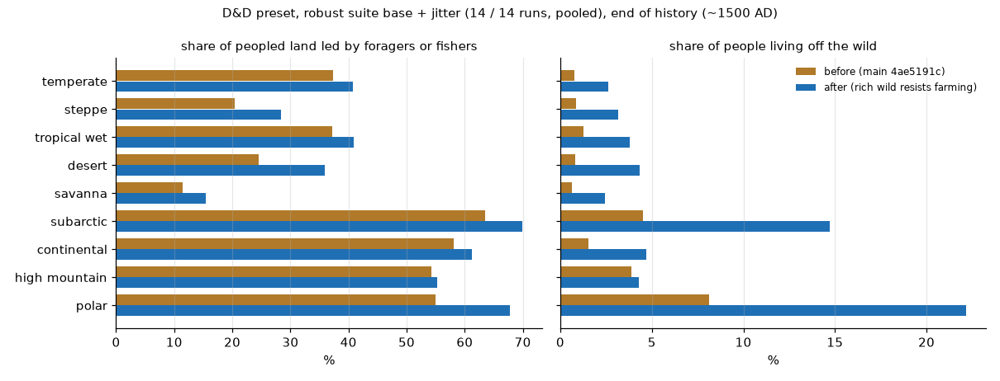

# Rich wild land resists farming (PW-1385 A)

Lane 141, 2026-11-02. Baseline = main 4ae5191c (plus the new `forage_land` measure only); after = this branch. The same 14 runs
of `tools/peoples_robust.py` each (D&D preset, families base + jitter, worlds 4360a3 and af2677, seeds 7/10/13, jitters 1-4),
end of the history (the tech tree's end, ~1500 AD). Tables from `rich_foragers.py` here.

## In plain words

- **What changed.** Before, a people that knew crops farmed every bit of farmable land it held. Now, where the waters are rich
  (the wild feeds several times what ordinary foraging does), it farms only part of that land at first and takes up more of it
  over the thousands of years it knows crops. Ordinary land is farmed exactly as before. Any people gets these foraging (fishing)
  portions. Herding now takes grazing land only where it feeds more people than foraging there.
- **Why per person, not per km2.** Ordinary foragers took up farming even though early farming paid about three-fifths as much per
  hour of work (Bowles 2011): the land, not the work, decided. Rich waters pay far more per hour (nets and weirs: thousands to
  tens of thousands of kcal an hour against seeds' few hundred, Kelly 2013), so there the work did decide. The rule reads how much
  richer the wild is than ordinary foraging and how long the people has known crops.
- **What it does at the end of the history (~1500 AD)**, against main at the same seeds (14 D&D runs each): the share of people
  living off the wild rises from 0.9% to 3.2%; the share of peopled land led by foragers or fishers from 34% to 39%. In temperate
  land 0.8% to 2.6% of people, 37% to 41% of the land. Farming kinds still farm 83-97% of their farmable land (was 100%): elves,
  hobgoblins and humans 95-97%, dragonborn 83% (they live on rich coasts most). Every farming kind now keeps a foraging fringe:
  dragonborn hold over 0.5 Mkm2 of forager-led land in 14 of 14 runs (was 8), orcs 11 (was 5), leonin 8 (was 1), goliaths 6 (was 3).
- **Total people fall 7%** (median 1,008 to 936 million): the rich coasts now feed foragers (~1 per km2) instead of farmers
  (~10-35). People shares hardly move (humans 22.8% to 22.4%; dragonborn 13.8% to 11.9%, the biggest change); no people dies out.
- **Cold land moves most:** people living off the wild go 4.5% to 15% in the subarctic and 8% to 22% on polar land, because
  there farming was thin and the fishing coasts are rich against it. Farmed people fall there (subarctic 166 to 145 million pooled,
  polar 39 to 27).
- **One thing to look at:** desert farmed people fall 12% (781 to 688 million pooled), steppe 11%. Some of that is fishing rivers
  and coasts in dry land; a desert river valley can be irrigated, and Earth's irrigated deserts (Nile, Mesopotamia) farmed in full.
  A first try without a floor on the richness index cut more there (18%) and was fixed (below); what is left is a draft for your
  decision (lean: leave it).
- **Herding barely moves:** herded people are the same within a few percent in every biome (the farmland given up goes partly to
  herds), and the share of herders sitting where the wild comes within half of herding falls on cold land (subarctic 63% to 38%).

## The sources

Every number below was read on the page linked (or in this folder's `ladder.md`, whose sources lane 130 read and lane 131
re-checked). "Search summary only" items are left out.

**Per hour, ordinary foraging beats early farming; farming won on land, not on work.**
- Bowles 2011, *PNAS* 108:4760, Table 3 ([PMC3064343](https://pmc.ncbi.nlm.nih.gov/articles/PMC3064343)): mean returns per hour of
  total labour, cultivated cereals 1,041 kcal/h against wild foods 1,662 kcal/h (0.63; 0.58-0.59 with risk and delay). "Data allowing
  economy-wide estimates of caloric return rates for these resource-rich foragers do not exist"; atypically rich resource
  concentrations were left out of the wild figure. So the ordinary forager took up farming at about three-fifths of its old returns
  per hour: what made it farm was the land (farms feed 100x more people a km2), not the work. That is the ladder's premise, and it
  stays for ordinary land.

**Rich wild foods return far more per hour than ordinary ones** (Kelly 2013, *The Lifeways of Hunter-Gatherers*, 2nd ed.,
Table 3-4 "postencounter return rates", archive.org text of the book,
[here](https://archive.org/stream/robert-l.-kelly-the-lifeways-of-hunter-gatherers-the-foraging-spectrum-cambridge/Robert%20L.%20Kelly%20-%20The%20Lifeways%20of%20Hunter-Gatherers_%20The%20Foraging%20Spectrum-Cambridge%20University%20Press%20%282013%29_djvu.txt)):
fish taken in weirs and gill nets ~5,600 to over 60,000 kcal/h (Georgia coast large fish; Great Basin trout 4,700-69,600 with
nets the top), boreal net fishing ~1,060-9,680, giant clams ~14,100; against seeds mostly under 1,500 (ricegrass 300-400, which Kelly
calls "a low return rate") and acorns ~480-1,200. These are post-encounter rates (search time left out), so they rank foods
rather than give a day's return; but they say that where fish can be taken in mass the wild pays several times what ordinary
foraging (and early farming) does per hour of work. The acorn row is a warning: California's acorns were not a high-return
food per hour; their richness was abundance and storage.

**Rich foragers' densities** (from `ladder.md`, Kelly 2013 Table 7-3 and Binford 2001 via D-PLACE): Northwest Coast 0.1-2 per km2
(Haida 0.62-0.96, Chinook 1.49, Puyallup 1.95), California ~0.1-9 (Eastern Pomo 2-6.3, Chumash 8.4-9); Binford's sedentary foragers
median 0.41; against the terrestrial fit 0.036 at NPP 330 and 0.11 at NPP 800. Calusa (SW Florida): "a total population of 21,000
for the Calusa domain does not seem out of line" over "perhaps over 10,000 square miles" (~26,000 km2: ~0.8 per km2 over the whole
domain), and "no more than 10 percent of the total population" lived in the interior: "a substantial economic focus on estuarine
resources" (Worth 2006, *The Social Geography of South Florida during the Spanish Colonial Era*, SAA paper,
[PDF](https://pages.uwf.edu/jworth/WorthSAA2006.pdf), read in full).

**How long they held out beside farmers.**
- *Calusa: never, to the Spanish.* Worth 2006: "this unique nonagricultural region sandwiched between the agricultural peoples of
  northern Florida and Cuba"; "the absence of corn agriculture from the southern Florida peninsula". Maize in the Southeast: "Maize
  de Ocho ... arrived c. 800 – c. 1000", the Mississippian c. AD 1000-1600
  ([Wikipedia, Mississippian culture](https://en.wikipedia.org/wiki/Mississippian_culture)). So >= ~0.55 kyr (AD ~1000 to the
  1560s) beside maize farmers, unfarmed.
- *Ertebølle (Denmark, S Sweden): ~1 kyr, then farmed.* "For nearly a millennium prior, farming was present in Europe but not southern
  Scandinavia"; "Ertebølle (5400-4000 B.C.) and Trichterbecher (4000-3500 B.C.) cultures" (NSF BCS-1135155, Price, doctoral grant
  abstract, 2011, [grantome](https://grantome.com/grant/NSF/BCS-1135155)). (Lane 139 anchored the crop lag on the same case.)
- *Jomon Japan: ~0.6 kyr to southern Tohoku; the cold north never.* "The introduction of rice agriculture into the Genkai Bay area
  of North Kyushu ... from around 1000 BC marks the beginning of the Yayoi period"; "Rice agriculture was established in Hokuriku and
  Tōhoku from 380 BC"; "settlements at the northern tip of Honshu failed by 100 BC, with occupants reverting to a hunting and
  gathering lifestyle"; North Tohoku and Hokkaido stay Epi-Jomon "to 700 AD" (de Boer, Yang, Kawagoe & Barnes 2020, *Evolutionary
  Human Sciences* 2:e13, [Cambridge](https://www.cambridge.org/core/product/BD91E69AEA3CCAEDC567519EF7F5AA97), read). The north's
  failure is cold (in the model: low farmability), not richness.
- *California and the Northwest Coast* never farmed staples to contact (`ladder.md`'s density rows; no date for the nearest
  farmers was read in this lane, so they set no number here; they are the "richest waters hold" end of the scale).

Not found (and so not used): salmon return rates per hour; Koyama's Jomon densities (the PDFs did not load); an Ertebølle
density; any per-hour labour number for the plough against the hoe (only search summaries). Because the plough's per-hour gain
was not sourced, the plough does not enter the rule (below).

## The mechanism

A cell's **richness** = its wild rung (`max(forager, fisher)`, before any raiding) over the land's own terrestrial forager rung
(Binford's fit at the cell's NPP), that rung never taken below the usual forager level (the fit at the reference land, 0.036 per
km2). It is 1 everywhere except on rich waters, and reads "how many times more the wild feeds here than ordinary foraging". This is
the per-person index the ticket asked for, not a density comparison with farming: the ordinary forager's returns per hour are
Bowles's "usual" level; rich waters run several times higher per hour (Kelly Table 3-4).

*Why the floor* (found in the first measured try): without it, a river with fish on poor land (desert, steppe, tundra) read as
hugely rich, because its own terrestrial foraging is tiny. That try cut farming on the Nile-like desert rivers, Earth's first
irrigation heartlands, by ~18% (desert farmed people 781 to 639 million, pooled over the 14 runs) and by 14-38% on steppe, subarctic
and polar land. With the floor, a desert river's fish count against ordinary foraging anywhere, not against the desert's.

Of a cell's farmable share, a people that has known crops for `t` kyr farms

    keep = 1 / (1 + x^2),   x = (richness - 1) / (RICH_HALF x (1 + t / RICH_T)),   RICH_HALF = 3, RICH_T = 1 kyr

and the rest of the cell stays wild (or herded, below). On ordinary land `keep` = 1 exactly (the ladder as before). Any people,
of any kind, gets these foraging portions. `t` is counted in half-kyr steps, capped at 15 kyr (Ladder.tech).

| richness (x the land's forager level) | farmed when crops are new | after 0.5 kyr | 1 kyr | 3 kyr | 10 kyr |
|---|---|---|---|---|---|
| 2 (a fair fishing coast) | 90% | 95% | 97% | 99% | 100% |
| 4 | 50% | 69% | 80% | 94% | 99% |
| 7 (Calusa's whole-domain mean, about) | 20% | 36% | 50% | 80% | 97% |
| 15 | 4% | 9% | 16% | 42% | 85% |
| 33 (the model's richest waters, fisher rung 1.2, on land at or under the reference NPP) | 1% | 2% | 3% | 12% | 52% |

What each constant is anchored on:
- **RICH_HALF = 3** (judgement on the cases): Calusa, about 7x the land's forager level (0.8 per km2 over a whole domain against the
  terrestrial fit's 0.05-0.11 for NPP 450-800; the SW Florida NPP itself was not looked up, so 7 is the low end of 7-16), still
  unfarmed ~0.55 kyr after maize next door: the rule leaves ~60% of such land wild at 0.5 kyr (~90% at the upper end of the range).
- **RICH_T = 1 kyr**: moderately rich coasts took up farming within about a thousand years of it arriving next door (Ertebølle
  ~1 kyr; Yayoi rice to southern Tohoku ~0.6 kyr). At richness 4 the rule farms half at once, 80% after 1 kyr, ~95% after 3.
- **The square** (judgement): from 90% to 10% farmed across a ninefold richness range; sharper would make a threshold.
- **At ~1500 AD**, a people that has farmed for ~10 kyr still leaves half of the richest waters (richness ~33) and ~15% of richness-15
  land wild, so foragers keep rare, real coastal regions; a late farmer (a kind slow to learn crops, PW-1373) keeps much more.

**Why not the plough as well.** Real holdouts were mostly next to hand-tool farmers (maize, rice), and the plough's per-hour gain was
not sourced; with time alone, rich land converts over millennia whatever the tools. A draft asks whether the plough stage should also
shorten it once a source is found.

**Herding: "which feeds more here".** Of a cell's grazable share a people that knows herding herds
`nomad^2 / (nomad^2 + wild^2)` (half where herding and the wild feed the same number, 80% where herding feeds twice as many). Lane 139
found herders and foragers feed similar numbers per km2 on cold and dry land (subarctic 68%, polar 49-63%, steppe 18-19% of herders
where foraging comes within half), so the plain comparison does bite there, unlike for farming; no labour margin is added, because
herding's returns per hour against foraging's were not sourced either, and the two are close in kind (both live off wild or
semi-wild grazing). A judgement, flagged in the drafts.

## Results

Before = main 4ae5191c, after = this branch, both the 14 D&D runs (base + jitter, worlds 4360a3 and af2677), pooled. "Wild-led land" = peopled cells whose people are mostly on the forager, fisher or raider rung (counted in cells, all 14 runs). "Farmable land farmed" = of the farmable land (the fertile good's share) in the cells each kind holds, the part it farms.

| biome | peopled cells (b / a) | wild-led land b | a | people on the wild b | a |
|---|---|---|---|---|---|
| temperate | 66146 / 66135 | 37.3% | 40.8% | 0.8% | 2.6% |
| steppe | 21010 / 20969 | 20.4% | 28.4% | 0.8% | 3.2% |
| savanna | 13195 / 13195 | 11.5% | 15.5% | 0.6% | 2.5% |
| tropical wet | 17059 / 17059 | 37.2% | 40.9% | 1.3% | 3.8% |
| desert | 16548 / 16523 | 24.6% | 35.9% | 0.8% | 4.3% |
| continental | 5947 / 5953 | 58.1% | 61.3% | 1.5% | 4.7% |
| high mountain | 5037 / 5040 | 54.3% | 55.3% | 3.9% | 4.3% |
| subarctic | 7426 / 7425 | 63.5% | 69.8% | 4.5% | 14.7% |
| polar | 1948 / 1951 | 54.9% | 67.8% | 8.1% | 22.2% |
| **all** | 154316 / 154250 | 34.3% | 39.4% | 0.9% | 3.2% |

| people | wild people b | a | wild-led Mkm2, median b | a | runs with >= 0.5 Mkm2 wild-led b | a | farmable land farmed b | a |
|---|---|---|---|---|---|---|---|---|
| human | 0.1% | 1.8% | 4.41 | 5.83 | 13/14 | 13/14 | 100.0% | 95.2% |
| hobgoblin | 0.1% | 1.4% | 3.84 | 4.13 | 13/14 | 13/14 | 100.0% | 96.4% |
| dragonborn | 0.1% | 3.4% | 0.53 | 4.61 | 8/14 | 14/14 | 100.0% | 82.7% |
| kenku | 0.2% | 4.2% | 5.58 | 6.26 | 13/14 | 14/14 | 100.0% | 94.9% |
| elf | 0.2% | 1.5% | 7.55 | 7.94 | 14/14 | 14/14 | 100.0% | 96.9% |
| orc | 0.0% | 1.8% | 0.04 | 0.98 | 5/14 | 11/14 | 100.0% | 88.8% |
| dwarf | 0.1% | 2.3% | 0.29 | 0.51 | 5/14 | 7/14 | 100.0% | 93.6% |
| leonin | 0.0% | 1.7% | 0.06 | 0.74 | 1/14 | 8/14 | 100.0% | 84.4% |
| halfling | 0.0% | 1.5% | 0.14 | 0.17 | 6/14 | 6/14 | 100.0% | 94.9% |
| bugbear | 0.6% | 2.5% | 1.41 | 1.66 | 11/14 | 11/14 | 100.0% | 92.3% |
| tabaxi | 0.4% | 5.0% | 3.01 | 3.51 | 8/14 | 8/14 | 100.0% | 93.5% |
| gnome | 0.7% | 3.2% | 2.03 | 2.25 | 9/14 | 9/14 | 100.0% | 95.3% |
| firbolg | 1.4% | 6.2% | 0.22 | 0.32 | 5/14 | 6/14 | 100.0% | 91.7% |
| goliath | 2.6% | 9.5% | 0.11 | 0.45 | 3/14 | 6/14 | 100.0% | 85.7% |
| kobold | 100.0% | 100.0% | 10.95 | 11.04 | 14/14 | 14/14 | - | - |
| drow | 0.1% | 1.7% | 0.04 | 0.07 | 0/14 | 0/14 | 100.0% | 97.2% |
| lizardfolk | 100.0% | 100.0% | 15.85 | 15.93 | 14/14 | 14/14 | - | - |
| aarakocra | 100.0% | 100.0% | 11.79 | 12.10 | 14/14 | 14/14 | - | - |
| triton | 100.0% | 100.0% | 3.44 | 3.44 | 14/14 | 14/14 | - | - |
| goblin | 44.6% | 46.2% | 3.16 | 3.30 | 12/14 | 14/14 | - | - |
| tortle | 100.0% | 100.0% | 2.92 | 2.93 | 14/14 | 14/14 | - | - |
| sea_elf | 100.0% | 100.0% | 1.21 | 1.19 | 14/14 | 14/14 | - | - |

Whole suite (same runs): total people median 1,008 to 936 million; commonest people's share median 29.8% to 29.5%; no people extinct before or after; shares within a point except dragonborn 13.8% to 11.9%.

Farmed and herded people by biome (million, pooled; `wild_overlap.py`): temperate farmed 6,548 to 6,271, steppe 2,151 to 1,915, savanna 2,000 to 1,845, tropical wet 1,576 to 1,511, desert 781 to 688, continental 330 to 318, high mountain 165 to 161, subarctic 166 to 145, polar 39 to 27; herded within a few percent everywhere (temperate 96 to 98, steppe 24 to 27, savanna 46 to 48). Herders where the wild comes within half of herding: all 7% to 8%; subarctic 63% to 38%, polar 58% to 46%, high mountain 9% to 40% (a handful of herders).

## How it was run

- Baseline: `git archive` of 4216b99b (main 4ae5191c + the `forage_land` measure) in scratch, `PLANET_DATA` the shared data root
  (read only), `--arms now --family base,jitter --trees dnd --jobs 6 --threads 2`. After: this branch, same command and seeds
  (run twice: the first without the richness floor, numbers quoted above; the tables are the second, as committed). ~7 min a run.
- Scratch outputs deleted after; the numbers are in the tables here.
