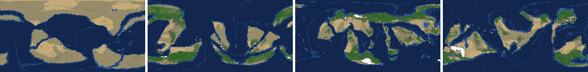
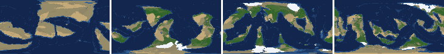
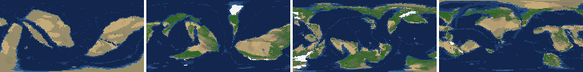
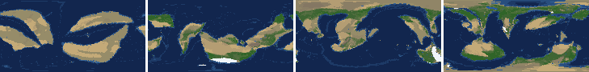
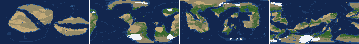
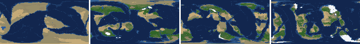
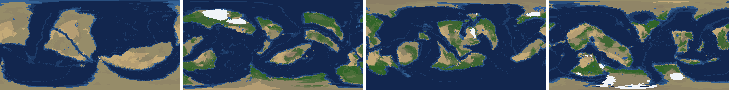
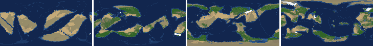

# Health sweep 2026-10-15 22:13

Commit 4326d64+dirty. 8 runs (default params, `--every 4`) at 8 workers x 2 numba threads; simulations 8.0 min wall. Made by `tools/health.py` (PW-246).

## Runs

| seed | L | Myr | run | sim s | trees / flowering trees from | dT range C | peaks > 9.5 km | giant-lake frames % | crust volume end/start | ice SL < -150 m % | <= 4 plates % |
|---|---|---|---|---|---|---|---|---|---|---|---|
| 1 | 6 | 1000 | c3fedb | 447 | 208 / 740 | 11.6 | 0 | 4.2 | 0.89 | 0.0 | 0.0 |
| 2 | 6 | 1000 | 0a4c41 | 444 | 228 / 732 | 19.7 | 0 | 1.3 | 0.917 | 0.0 | 0.0 |
| 11 | 6 | 1000 | e85d55 | 448 | 224 / 684 | 17.0 | 0 | 11.8 | 0.903 | 7.1 | 5.0 |
| 21 | 6 | 1000 | 064368 | 446 | 224 / 768 | 13.1 | 0 | 6.7 | 0.914 | 0.0 | 0.0 |
| 3199 | 6 | 1000 | 35c740 | 448 | 252 / 744 | 9.1 | 0 | 2.5 | 0.916 | 0.0 | 0.0 |
| 42 | 6 | 1000 | fcd857 | 450 | 212 / 812 | 11.7 | 0 | 3.8 | 0.908 | 0.0 | 0.0 |
| 77 | 6 | 1000 | f6b1e0 | 453 | 240 / 788 | 16.4 | 0 | 8.8 | 0.921 | 0.0 | 0.0 |
| 505 | 6 | 1000 | 0d4927 | 445 | 248 / 764 | 9.0 | 0 | 2.1 | 0.906 | 0.0 | 1.7 |

## Medians by seed (after 50 Myr; tree cover after forests, NPP after flowering trees appear)

| seed | L | land_pct | cont_pct | cont_km | plates | ocean_age | speed | sea_level | sea_ice_m | ice_pct | temp | co2 | dry_pct | inland_pct | lake_pct | lake_max_mkm2 | max_elev_km | trees_pct | npp | landmasses | largest_pct |
|---|---|---|---|---|---|---|---|---|---|---|---|---|---|---|---|---|---|---|---|---|---|
| 1 | 6 | 31.5 | 39.6 | 34.1 | 11.0 | 63.2 | 4.0 | 24.5 | -3.3 | 0.7 | 15.4 | -0.3 | 25.6 | 4.1 | 0.5 | 0.1 | 6.2 | 31.9 | 356.0 | 8.0 | 20.3 |
| 2 | 6 | 31.0 | 40.1 | 34.1 | 12.0 | 55.9 | 4.0 | 154.0 | -9.7 | 1.5 | 13.8 | -0.1 | 17.2 | 2.9 | 0.5 | 0.1 | 6.3 | 38.2 | 355.0 | 8.0 | 21.4 |
| 11 | 6 | 31.3 | 40.0 | 33.6 | 8.0 | 69.0 | 4.0 | -70.9 | -3.7 | 0.7 | 15.9 | -0.3 | 23.3 | 4.1 | 0.7 | 0.2 | 6.8 | 33.9 | 364.4 | 9.0 | 17.4 |
| 21 | 6 | 32.5 | 39.1 | 34.7 | 11.5 | 54.7 | 4.5 | 83.9 | -3.4 | 0.6 | 16.9 | -0.1 | 28.6 | 3.6 | 0.4 | 0.1 | 6.4 | 24.2 | 291.3 | 9.0 | 22.2 |
| 3199 | 6 | 31.9 | 39.8 | 34.4 | 11.0 | 52.8 | 4.4 | 84.0 | -5.5 | 0.9 | 14.9 | -0.2 | 23.6 | 3.6 | 0.6 | 0.1 | 6.0 | 33.9 | 375.9 | 8.0 | 15.1 |
| 42 | 6 | 29.9 | 40.2 | 33.1 | 13.0 | 56.0 | 4.2 | 148.9 | -3.1 | 0.6 | 15.3 | -0.1 | 23.6 | 2.8 | 0.5 | 0.1 | 6.7 | 31.9 | 381.1 | 14.0 | 13.4 |
| 77 | 6 | 31.1 | 40.7 | 34.1 | 14.0 | 50.0 | 4.0 | 47.5 | -2.9 | 0.4 | 14.1 | -0.2 | 20.6 | 2.5 | 0.6 | 0.1 | 5.9 | 36.9 | 337.5 | 11.0 | 13.5 |
| 505 | 6 | 31.2 | 40.1 | 34.0 | 11.0 | 57.8 | 4.2 | 127.2 | -3.8 | 0.7 | 15.6 | -0.2 | 25.3 | 3.8 | 0.4 | 0.1 | 6.7 | 29.9 | 382.9 | 7.0 | 19.1 |

Measured on the run's keyframes (no slicing). A keyframe's rivers and lakes are routed on its own terrain (PW-239), so `inland_raw_pct` (every routed end on land, as highlights counts it) and `inland_pct` (ends that are closed lakes, salt pans or real pits) agree but for ends under land ice. Land ice and land shares use cells (near-equal area).

## Envelopes

| metric | low | high | Earth | source |
|---|---|---|---|---|
| land, % of surface (`land_pct`) | 22 | 42 | 29.20 | tests/test_envelopes.py (22-42%); Earth 29.2% |
| continental crust, % of surface (`cont_pct`) | 33 | 50 | 41 | tests/test_envelopes.py (33-50%); Earth ~41% with shelves (Cogley 1984) |
| mean continental crust thickness, km (`cont_km`) | 31 | 40 | 39 | target 35 km (PW-238, continental_thickness); Earth ~39 km (Christensen & Mooney 1995); known thinning to 32-33 km (PW-046) |
| plates (`plates`) | 5 | 30 | 15 | tests/test_envelopes.py (5-30; max_plates 30); Earth 7 major + ~8 minor; <= 4 is the PW-191 collapse |
| mean ocean-floor age, Myr (`ocean_age`) | 25 | 120 | 64 | tests/test_envelopes.py (25-120); Earth ~64 Myr (Mueller et al. 2008); PW-051 |
| mean plate speed, cm/yr (`speed`) | 2 | 9 | 4.50 | tests/test_envelopes.py (2-9 cm/yr); Earth ~4-5 |
| sea level, m (ice + ocean basins) (`sea_level`) | -250 | 300 | 0 | Phanerozoic ~-130 (LGM) .. +250 m (earth.py; Haq & Schutter 2008); -250: PW-240's hard goal |
| sea level from land ice, m (`sea_ice_m`) | -250 | - | 0 | Earth LGM ~-130 m; PW-240 goal -150 m typical / -250 m worst |
| land ice, % of surface (`ice_pct`) | - | 10 | 3.10 | Earth 3.1% now (earth.EARTH_ICE), ~7-8% at the LGM |
| global mean temperature, C (`temp`) | 8 | 30 | 14.50 | Earth 14.5 C; LGM ~8 C (Tierney et al. 2020); Phanerozoic hothouses to ~30 C (Scotese et al. 2021) |
| CO2 index (ln source/sink) (`co2`) | -1.5 | 1.5 | 0.00 | the forcing's clip in earth.py (+-1.5); Earth 0 |
| arid (Koppen B), % of land (`dry_pct`) | 12 | 45 | 30 | tests/test_envelopes.py (12-45%); Earth ~30% (Beck et al. 2018) |
| land draining inland, % of ice-free land (to a closed lake, salt pan or real pit) (`inland_pct`) | 8 | 30 | 18 | Earth ~18% (overview 2.9); L6 known ~9.5-11% (PW-054, PW-243). `inland_raw_pct` (not checked) follows the stored `downstream` to any end, as highlights does; since PW-239 the two agree but for ends under land ice |
| lakes, % of land (`lake_pct`) | 0.2 | 3.0 | 1.80 | Earth ~1.8% of ice-free land (HydroLAKES, Messager et al. 2016); generated L6 worlds 0.5-1% |
| largest lake, million km2 (`lake_max_mkm2`) | - | 1.0 | 0.37 | Caspian 0.37 Mkm2; 1 Mkm2 = the overview's giant lake (2.9) |
| highest peak, km (`max_elev_km`) | - | 9.5 | 8.85 | Everest 8.85 km; PW-172 (spikes above ~9.5 km) |
| tree cover, % of ice-free land (after forests appear) (`trees_pct`) | 10 | 50 | 30 | Earth ~30% potential canopy (forest 55-60 of ~130 Mkm2, overview 2.18) |
| land NPP, g C/m2/yr (after flowering trees appear) (`npp`) | 200 | 700 | 430 | Earth ~56 Pg C/yr over ~130 Mkm2 = ~430; the model on Earth's terrain 50 Pg C/yr, ~385 (overview 2.18). Before flowering trees (plant group 4) stand-ins grow at 70%, so runs sit at ~150-280 |
| landmasses (>= 3 cells) (`landmasses`) | 3 | 80 | - | loose: a lone supercontinent or a shattered archipelago |
| largest landmass, % of surface (`largest_pct`) | 5 | 35 | 16.60 | Afro-Eurasia 16.6%; a Pangaea ~30% (scorecard largest_max) |
| global temperature range over the run, C (`dT_range`, per run) | - | 25 | 25 | Phanerozoic 11-36 C (Scotese et al. 2021) |
| keyframes with a peak above 9.5 km (`peak_frames`, per run) | - | 0 | 0 | PW-172 (L7 seed 3199: 3 of 251) |
| % of keyframes with a lake over 1 Mkm2 (`giant_lake_frames`, per run) | - | 5 | 0 | overview 2.9 (L6: 3 of ~150 frames) |
| continental crust volume, end / start (`volume_ratio`, per run) | 0.9 | 1.1 | 1.0 | scorecard volume_ratio (x1.006) |
| % of keyframes with ice sea level below -150 m (`sea_ice_below_150`, per run) | - | 10 | 0 | PW-240 |
| % of keyframes with <= 4 plates (`low_plates`, per run) | - | 2 | 0 | PW-191 (L7 seed 21: 1%) |

## Top outliers (of 219 spells; severity = excess / band width x (0.2 + share of the run))

| seed | L | metric | Myr | frames | worst | envelope | severity |
|---|---|---|---|---|---|---|---|
| 11 | 6 | low_plates | run | - | 5.00 | -..2 | 1.5 |
| 11 | 6 | giant_lake_frames | run | - | 11.80 | -..5 | 1.36 |
| 3199 | 6 | lake_max_mkm2 | 68-72 | 2 | 5.17 | -..1.0 | 0.867 |
| 77 | 6 | lake_max_mkm2 | 300-332 | 9 | 4.36 | -..1.0 | 0.792 |
| 77 | 6 | giant_lake_frames | run | - | 8.80 | -..5 | 0.76 |
| 21 | 6 | lake_max_mkm2 | 212-212 | 1 | 4.36 | -..1.0 | 0.685 |
| 42 | 6 | lake_max_mkm2 | 796-804 | 3 | 3.96 | -..1.0 | 0.627 |
| 11 | 6 | lake_max_mkm2 | 380-396 | 5 | 3.60 | -..1.0 | 0.572 |
| 42 | 6 | lake_max_mkm2 | 76-76 | 1 | 3.72 | -..1.0 | 0.555 |
| 11 | 6 | lake_max_mkm2 | 248-272 | 6 | 3.35 | -..1.0 | 0.526 |
| 21 | 6 | lake_max_mkm2 | 164-168 | 2 | 3.46 | -..1.0 | 0.512 |
| 21 | 6 | lake_max_mkm2 | 524-544 | 5 | 3.23 | -..1.0 | 0.489 |
| 21 | 6 | lake_max_mkm2 | 148-152 | 2 | 3.20 | -..1.0 | 0.458 |
| 11 | 6 | lake_max_mkm2 | 356-368 | 3 | 2.91 | -..1.0 | 0.406 |
| 11 | 6 | lake_max_mkm2 | 408-432 | 6 | 2.78 | -..1.0 | 0.398 |
| 1 | 6 | lake_max_mkm2 | 52-52 | 1 | 2.85 | -..1.0 | 0.378 |
| 21 | 6 | giant_lake_frames | run | - | 6.70 | -..5 | 0.34 |
| 77 | 6 | lake_max_mkm2 | 64-84 | 5 | 2.53 | -..1.0 | 0.336 |
| 77 | 6 | lake_max_mkm2 | 664-668 | 2 | 2.59 | -..1.0 | 0.331 |
| 42 | 6 | inland_pct | 256-1000 | 185 | 0.39 | 8..30 | 0.324 |
| 2 | 6 | inland_pct | 284-1000 | 180 | 0.47 | 8..30 | 0.314 |
| 77 | 6 | inland_pct | 284-1000 | 178 | 0.54 | 8..30 | 0.308 |
| 3199 | 6 | inland_pct | 380-1000 | 153 | 0.17 | 8..30 | 0.288 |
| 21 | 6 | lake_max_mkm2 | 64-64 | 1 | 2.34 | -..1.0 | 0.274 |
| 77 | 6 | lake_max_mkm2 | 348-348 | 1 | 2.28 | -..1.0 | 0.261 |
| 505 | 6 | lake_max_mkm2 | 56-56 | 1 | 2.18 | -..1.0 | 0.24 |
| 11 | 6 | inland_pct | 496-1000 | 124 | 0.43 | 8..30 | 0.239 |
| 1 | 6 | inland_pct | 532-1000 | 116 | 0.91 | 8..30 | 0.213 |
| 21 | 6 | lake_max_mkm2 | 184-184 | 1 | 2.02 | -..1.0 | 0.207 |
| 21 | 6 | inland_pct | 664-1000 | 84 | 0.33 | 8..30 | 0.186 |

## Per seed: min / median / max after the 50 Myr spin-up, and spells outside the envelopes

### Seed 1, L6 (run c3fedb)

*At 100, 400, 700, 1000 Myr: sea by depth, land green by tree cover / tan where arid, shaded by height, ice white, lakes blue.*

| metric | min | median | max | outside (Myr: worst) |
|---|---|---|---|---|
| land_pct | 29.84 | 31.51 | 38.56 |  |
| cont_pct | 37.72 | 39.58 | 43.01 |  |
| cont_km | 31.86 | 34.12 | 37.80 |  |
| plates | 6.00 | 11.00 | 17.00 |  |
| ocean_age | 30.50 | 63.15 | 99.10 |  |
| speed | 2.29 | 3.98 | 8.40 |  |
| sea_level | -196.60 | 24.55 | 224.70 |  |
| sea_ice_m | -25.70 | -3.35 | -0.00 |  |
| ice_pct | 0.00 | 0.70 | 2.10 |  |
| temp | 8.90 | 15.35 | 20.50 |  |
| co2 | -1.09 | -0.32 | 0.14 |  |
| dry_pct | 15.53 | 25.63 | 57.30 | 136-240: 57.30 |
| inland_pct | 0.28 | 4.05 | 24.40 | 72-72: 4.14; 84-112: 1.51; 124-148: 4.01; 172-200: 7.29; +3 more |
| lake_pct | 0.07 | 0.50 | 3.70 | 52-52: 3.70; 64-72: 0.10; 84-124: 0.07; 140-140: 0.12 |
| lake_max_mkm2 | 0.01 | 0.09 | 2.85 | 52-52: 2.85; 524-532: 1.58; 628-632: 1.58; 652-652: 1.32; +2 more |
| max_elev_km | 1.95 | 6.16 | 8.40 |  |
| trees_pct | 13.09 | 31.86 | 45.69 |  |
| npp | 226.30 | 356.00 | 399.70 |  |
| landmasses | 1.00 | 8.00 | 17.00 | 52-52: 2; 172-216: 1; 228-252: 1 |
| largest_pct | 7.30 | 20.30 | 34.60 |  |

### Seed 2, L6 (run 0a4c41)

*At 100, 400, 700, 1000 Myr: sea by depth, land green by tree cover / tan where arid, shaded by height, ice white, lakes blue.*

| metric | min | median | max | outside (Myr: worst) |
|---|---|---|---|---|
| land_pct | 28.32 | 30.99 | 37.93 |  |
| cont_pct | 36.96 | 40.06 | 43.36 |  |
| cont_km | 31.24 | 34.06 | 38.30 |  |
| plates | 6.00 | 12.00 | 16.00 |  |
| ocean_age | 31.60 | 55.90 | 74.00 |  |
| speed | 2.44 | 4.03 | 7.64 |  |
| sea_level | -28.40 | 154.00 | 234.60 |  |
| sea_ice_m | -125.00 | -9.70 | -0.00 |  |
| ice_pct | 0.00 | 1.50 | 7.90 |  |
| temp | 3.70 | 13.80 | 23.40 | 480-532: 3.70; 608-608: 7.80 |
| co2 | -1.04 | -0.14 | 0.77 |  |
| dry_pct | 12.45 | 17.23 | 55.85 | 52-60: 51.92; 80-88: 47.05; 220-248: 55.85 |
| inland_pct | 0.47 | 2.93 | 25.29 | 64-144: 1.09; 264-264: 7.66; 284-1000: 0.47 |
| lake_pct | 0.07 | 0.52 | 2.57 | 56-84: 0.07; 112-136: 0.08; 428-428: 0.16 |
| lake_max_mkm2 | 0.01 | 0.11 | 1.56 | 52-52: 1.52; 152-152: 1.32; 840-840: 1.56 |
| max_elev_km | 1.84 | 6.32 | 8.19 |  |
| trees_pct | 7.51 | 38.20 | 58.07 | 232-248: 7.51; 276-284: 8.17; 492-540: 54.46; 720-720: 50.55; +1 more |
| npp | 231.90 | 355.00 | 401.30 |  |
| landmasses | 2.00 | 8.00 | 16.00 | 52-68: 2 |
| largest_pct | 7.80 | 21.40 | 33.70 |  |

### Seed 11, L6 (run e85d55)

*At 100, 400, 700, 1000 Myr: sea by depth, land green by tree cover / tan where arid, shaded by height, ice white, lakes blue.*

| metric | min | median | max | outside (Myr: worst) |
|---|---|---|---|---|
| land_pct | 27.89 | 31.34 | 38.20 |  |
| cont_pct | 38.77 | 39.97 | 43.02 |  |
| cont_km | 31.80 | 33.64 | 36.56 |  |
| plates | 4.00 | 8.00 | 20.00 | 184-228: 4 |
| ocean_age | 36.10 | 68.95 | 96.90 |  |
| speed | 1.66 | 4.00 | 7.33 | 872-888: 1.66 |
| sea_level | -415.20 | -70.90 | 217.50 | 188-256: -415.20 |
| sea_ice_m | -322.20 | -3.70 | -0.00 | 188-232: -322.20 |
| ice_pct | 0.00 | 0.70 | 14.20 | 184-240: 14.20 |
| temp | 3.20 | 15.85 | 20.20 | 172-216: 3.20 |
| co2 | -1.29 | -0.32 | 0.29 |  |
| dry_pct | 11.29 | 23.34 | 44.22 | 612-632: 11.29; 816-816: 11.98 |
| inland_pct | 0.43 | 4.10 | 31.10 | 64-184: 0.66; 196-208: 5.67; 240-304: 4.40; 324-332: 6.23; +6 more |
| lake_pct | 0.08 | 0.73 | 4.71 | 68-68: 0.12; 80-88: 0.09; 100-124: 0.08; 332-332: 3.73; +3 more |
| lake_max_mkm2 | 0.03 | 0.17 | 3.60 | 144-144: 1.02; 184-184: 1.26; 208-212: 1.12; 248-272: 3.35; +7 more |
| max_elev_km | 1.40 | 6.78 | 8.46 |  |
| trees_pct | 14.75 | 33.86 | 49.98 |  |
| npp | 249.20 | 364.40 | 419.20 |  |
| landmasses | 2.00 | 9.00 | 17.00 | 212-232: 2 |
| largest_pct | 5.90 | 17.40 | 35.60 | 212-232: 35.60 |

### Seed 21, L6 (run 064368)

*At 100, 400, 700, 1000 Myr: sea by depth, land green by tree cover / tan where arid, shaded by height, ice white, lakes blue.*

| metric | min | median | max | outside (Myr: worst) |
|---|---|---|---|---|
| land_pct | 30.16 | 32.48 | 37.92 |  |
| cont_pct | 37.04 | 39.05 | 43.92 |  |
| cont_km | 30.64 | 34.70 | 37.52 | 884-924: 30.64 |
| plates | 8.00 | 11.50 | 19.00 |  |
| ocean_age | 34.40 | 54.70 | 99.70 |  |
| speed | 1.65 | 4.50 | 7.07 | 784-784: 1.65 |
| sea_level | -253.60 | 83.90 | 207.60 | 760-760: -253.60 |
| sea_ice_m | -82.20 | -3.40 | -0.00 |  |
| ice_pct | 0.00 | 0.60 | 5.90 |  |
| temp | 9.40 | 16.90 | 22.50 |  |
| co2 | -0.90 | -0.14 | 0.59 |  |
| dry_pct | 11.41 | 28.59 | 47.98 | 52-60: 47.98; 760-768: 11.41; 788-792: 11.68 |
| inland_pct | 0.33 | 3.61 | 19.40 | 68-128: 1.54; 160-160: 3.32; 172-176: 7.07; 188-188: 5.81; +6 more |
| lake_pct | 0.07 | 0.39 | 4.74 | 72-72: 0.19; 88-120: 0.07; 148-148: 3.11; 212-212: 4.74; +12 more |
| lake_max_mkm2 | 0.01 | 0.09 | 4.36 | 64-64: 2.34; 148-152: 3.20; 164-168: 3.46; 184-184: 2.02; +4 more |
| max_elev_km | 1.47 | 6.44 | 8.41 |  |
| trees_pct | 10.23 | 24.22 | 59.69 | 756-788: 59.69 |
| npp | 241.90 | 291.30 | 341.50 |  |
| landmasses | 2.00 | 9.00 | 18.00 | 60-60: 2; 204-204: 2; 256-268: 2; 284-284: 2 |
| largest_pct | 12.60 | 22.20 | 34.30 |  |

### Seed 3199, L6 (run 35c740)

*At 100, 400, 700, 1000 Myr: sea by depth, land green by tree cover / tan where arid, shaded by height, ice white, lakes blue.*

| metric | min | median | max | outside (Myr: worst) |
|---|---|---|---|---|
| land_pct | 29.96 | 31.90 | 38.83 |  |
| cont_pct | 36.90 | 39.80 | 43.12 |  |
| cont_km | 32.03 | 34.38 | 38.01 |  |
| plates | 8.00 | 11.00 | 16.00 |  |
| ocean_age | 35.50 | 52.80 | 63.10 |  |
| speed | 2.83 | 4.36 | 7.15 |  |
| sea_level | -35.10 | 84.00 | 183.60 |  |
| sea_ice_m | -56.00 | -5.50 | -0.00 |  |
| ice_pct | 0.00 | 0.90 | 4.30 |  |
| temp | 11.50 | 14.95 | 20.60 |  |
| co2 | -0.84 | -0.19 | 0.55 |  |
| dry_pct | 8.92 | 23.65 | 61.41 | 52-76: 61.41; 208-208: 45.99; 220-220: 45.15; 496-544: 8.92; +1 more |
| inland_pct | 0.17 | 3.62 | 23.26 | 76-136: 2.37; 268-272: 5.00; 284-312: 4.08; 328-368: 1.28; +1 more |
| lake_pct | 0.14 | 0.56 | 2.93 | 76-76: 0.17; 104-108: 0.14; 132-132: 0.18; 628-628: 0.17 |
| lake_max_mkm2 | 0.03 | 0.14 | 5.17 | 68-72: 5.17; 116-116: 1.43; 500-500: 1.13; 804-804: 1.46; +1 more |
| max_elev_km | 1.63 | 5.98 | 8.31 |  |
| trees_pct | 22.90 | 33.92 | 48.64 |  |
| npp | 232.80 | 375.90 | 407.20 |  |
| landmasses | 2.00 | 8.00 | 16.00 | 52-64: 2; 192-192: 2 |
| largest_pct | 8.90 | 15.05 | 33.20 |  |

### Seed 42, L6 (run fcd857)

*At 100, 400, 700, 1000 Myr: sea by depth, land green by tree cover / tan where arid, shaded by height, ice white, lakes blue.*

| metric | min | median | max | outside (Myr: worst) |
|---|---|---|---|---|
| land_pct | 26.31 | 29.88 | 38.25 |  |
| cont_pct | 37.43 | 40.22 | 42.74 |  |
| cont_km | 31.42 | 33.12 | 37.01 |  |
| plates | 7.00 | 13.00 | 20.00 |  |
| ocean_age | 35.90 | 56.05 | 68.00 |  |
| speed | 2.61 | 4.19 | 7.47 |  |
| sea_level | 35.10 | 148.90 | 224.50 |  |
| sea_ice_m | -16.00 | -3.10 | -0.00 |  |
| ice_pct | 0.00 | 0.60 | 2.60 |  |
| temp | 9.80 | 15.30 | 21.50 |  |
| co2 | -1.17 | -0.10 | 0.50 |  |
| dry_pct | 15.96 | 23.65 | 40.47 |  |
| inland_pct | 0.39 | 2.78 | 13.05 | 64-160: 0.76; 180-180: 6.63; 192-192: 7.69; 204-216: 5.79; +2 more |
| lake_pct | 0.08 | 0.52 | 3.59 | 64-92: 0.08; 104-104: 0.12; 572-600: 0.11; 616-628: 0.17; +2 more |
| lake_max_mkm2 | 0.01 | 0.11 | 3.96 | 76-76: 3.72; 96-100: 1.83; 168-168: 1.87; 796-804: 3.96; +2 more |
| max_elev_km | 1.89 | 6.69 | 8.94 |  |
| trees_pct | 19.67 | 31.87 | 47.25 |  |
| npp | 278.90 | 381.10 | 413.00 |  |
| landmasses | 3.00 | 14.00 | 24.00 |  |
| largest_pct | 7.10 | 13.40 | 32.80 |  |

### Seed 77, L6 (run f6b1e0)

*At 100, 400, 700, 1000 Myr: sea by depth, land green by tree cover / tan where arid, shaded by height, ice white, lakes blue.*

| metric | min | median | max | outside (Myr: worst) |
|---|---|---|---|---|
| land_pct | 29.70 | 31.15 | 38.64 |  |
| cont_pct | 35.28 | 40.67 | 44.59 |  |
| cont_km | 30.73 | 34.11 | 39.36 | 928-952: 30.73 |
| plates | 8.00 | 14.00 | 19.00 |  |
| ocean_age | 33.70 | 49.95 | 69.90 |  |
| speed | 2.56 | 3.99 | 8.18 |  |
| sea_level | -93.70 | 47.55 | 174.90 |  |
| sea_ice_m | -63.20 | -2.90 | -0.00 |  |
| ice_pct | 0.00 | 0.40 | 5.80 |  |
| temp | 5.90 | 14.10 | 22.30 | 136-152: 5.90 |
| co2 | -0.76 | -0.20 | 0.37 |  |
| dry_pct | 10.86 | 20.62 | 43.22 | 336-356: 10.86; 452-456: 11.76; 524-528: 11.80 |
| inland_pct | 0.47 | 2.50 | 31.99 | 68-160: 0.47; 172-172: 7.87; 188-188: 31.99; 236-236: 7.41; +2 more |
| lake_pct | 0.07 | 0.55 | 4.35 | 56-56: 0.15; 76-76: 0.18; 88-88: 0.18; 104-108: 0.07; +3 more |
| lake_max_mkm2 | 0.01 | 0.15 | 4.36 | 64-84: 2.53; 116-116: 1.20; 188-188: 1.08; 224-224: 1.82; +4 more |
| max_elev_km | 1.63 | 5.86 | 8.43 |  |
| trees_pct | 20.52 | 36.94 | 51.94 | 524-532: 51.94 |
| npp | 212.30 | 337.50 | 347.20 |  |
| landmasses | 2.00 | 11.00 | 23.00 | 52-56: 2 |
| largest_pct | 5.70 | 13.50 | 31.60 |  |

### Seed 505, L6 (run 0d4927)

*At 100, 400, 700, 1000 Myr: sea by depth, land green by tree cover / tan where arid, shaded by height, ice white, lakes blue.*

| metric | min | median | max | outside (Myr: worst) |
|---|---|---|---|---|
| land_pct | 28.34 | 31.25 | 38.14 |  |
| cont_pct | 36.79 | 40.14 | 43.36 |  |
| cont_km | 31.97 | 33.98 | 37.69 |  |
| plates | 4.00 | 11.00 | 18.00 | 740-756: 4 |
| ocean_age | 33.60 | 57.80 | 90.60 |  |
| speed | 2.31 | 4.17 | 7.31 |  |
| sea_level | -172.70 | 127.25 | 231.90 |  |
| sea_ice_m | -14.70 | -3.75 | -0.00 |  |
| ice_pct | 0.00 | 0.70 | 3.00 |  |
| temp | 11.40 | 15.60 | 20.40 |  |
| co2 | -0.73 | -0.16 | 0.37 |  |
| dry_pct | 10.80 | 25.33 | 41.43 | 864-876: 10.80 |
| inland_pct | 0.37 | 3.79 | 21.39 | 60-204: 0.59; 216-240: 3.32; 252-268: 3.58; 280-280: 6.06; +4 more |
| lake_pct | 0.09 | 0.43 | 1.80 | 64-64: 0.09; 80-112: 0.10; 372-376: 0.17; 392-416: 0.13; +3 more |
| lake_max_mkm2 | 0.01 | 0.09 | 2.18 | 56-56: 2.18; 108-108: 1.46; 120-128: 1.78; 904-904: 1.18 |
| max_elev_km | 1.86 | 6.67 | 8.37 |  |
| trees_pct | 16.67 | 29.93 | 38.29 |  |
| npp | 225.50 | 382.95 | 406.10 |  |
| landmasses | 2.00 | 7.00 | 20.00 | 56-60: 2; 176-180: 2 |
| largest_pct | 7.30 | 19.10 | 34.40 |  |

## Determinism

Seed 1 L6 re-run to 100 Myr (run fd6086) against the sweep's run c3fedb: 26 keyframes x 43 layers, **bit-identical** (layer hashes and frame stats).
