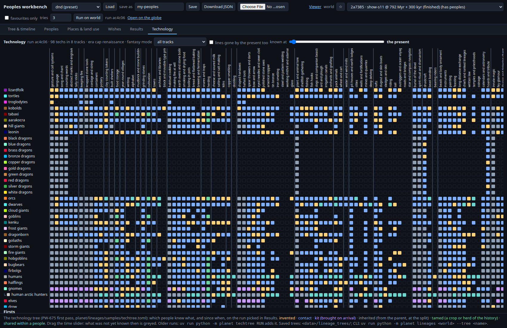
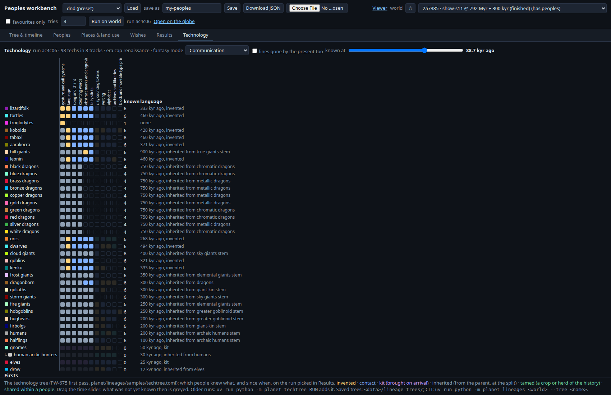

# Technology tree, first pass (PW-675 prototype, fun lane 39)

Owner's request (overnight): "a first pass at our technology tree, starting as early as language which need not arise everywhere at once. Let the dragons and other older species come up with it where reasonable or early comers like gnomes have it when they arrive to this plane." It is a prototype: nothing here is final.

## What it is

- **Data:** `planet/lineages/samples/techtree.toml`, with **8 tracks and 98 techs**: communication (gesture, language, song, counting, marks, tallies, tokens, writing, alphabet, libraries, printing), fire and cooking (keeping fire, cooking, fire-making, earth ovens, smoking, pot boiling, bread, fermentation, cheese, salting, kilns, distilling), tools and materials (knapping to steel, arsenical copper and tin bronze, glass, mithril), food getting (foraging lore, shellfish, fishing, hooks, traps, storage, cultivation, herding, dogs, plough, irrigation, orchards, mills), shelter and settlement (huts to cities, walls, mines, dwarven delving), travel (rafts, canoes, sledges, pack animals, wheel, riding, sail, outriggers, roads, navigation, sky mounts), social and ritual (ornament, burial, music, painting, ritual, feasting, trade, chiefs, law, temples, coinage, calendars, dragon hoards), and magic (innate dragon magic, druidcraft, fey glamour, illusion, tide lore, elemental pacts, runes, beast bonding, wizardry, arcane schools, enchanting; fantasy mode only).
- Each tech lists its **needs** (prerequisites), the **land goods** it needs in the people's country (land.GOODS: copper, tin, iron, salt, grazing, farmland, frost...), a **real-world earliest date** with its **source**, a **rate**, an **era** (the tree's `meta.era`, default renaissance, caps what any people reaches) and **hands** (dragons have none).
- **[[kind]] rules** (by line id, applied down the tree): dragons are an *elder* kind (an earlier `elder_kyr` date, no hands, an innate-magic kit, slow inventors); true giants are elder; gnomes (arriving at 50 kyr from the feywild), elves, tritons and the edge folk bring a **kit** on arrival; dwarves invent a little faster.
- **Model:** `planet/lineages/techtree.py`, run after the history in `output.save` (stored as `meta.techtree` plus a few lines in run.txt). `planet techtree RUN` builds it for a stored run.

## How acquisition and diffusion work

All rules are seeded `(try seed, 675)` and stepped over 360 log-spaced steps from the oldest line to the present:
1. **Inventing.** A living people may invent a tech once it knows the tech's needs, its present range holds the goods (a deposit such as ore or salt in a few cells, a living good on 4% of the range), it has hands if the tech needs them, and the time is past the earliest date (or the elder date for elder kinds). The chance per kyr is `rate x kind.rate_x x size`, where size is a log of the people's population. Techs no older than 12 kyr are found at least 0.12 per kyr, so the Holocene chains get climbed.
2. **Inheritance and kits.** A split inherits what its parent knew at the split, and a hybrid what both parents knew. A group (a way of life) and its people share what they know. An arrival brings its kit, closed under its needs.
3. **The history's tamings.** Whoever first cultivated a crop (crops.py) or tamed or took up a herd animal (animals.py) knows cultivation or herding from that date.
4. **Diffusion.** While two peoples are in contact (contacts.Contacts: the first contact, the border series), a tech one knows passes to the other at `0.15/kyr x spread x border/1500 km x (1 - 0.7 insularity)`. Traded techs (bronze, iron) pass without the ore. **Language and gesture have spread 0: they never pass by contact.** Each stem finds language on its own, possible from 500 kyr (2 Myr for elder kinds) at about 0.01 per kyr. So language does not arise everywhere at once.

## On three planets (dnd preset, one try each, L7; runs 3097e3, ac4c06, 2cb509)

| | 2a7385 (run 3097e3) | 1df1c3 (run ac4c06) |
|---|---|---|
| language first | chromatic dragons 1.8 Myr | chromatic dragons 1.8 Myr |
| language in the younger stems | dwarves, orcs, tortles ~494 kyr ... leonin 358 kyr; humans inherit at 200 kyr | dwarves 494 kyr ... orcs 268 kyr; one people (troglodytes) never |
| keeping fire | avian stem 978 kyr | true giants 1.17 Myr |
| bow / pottery | kenku 64 kyr / firbolgs 19 kyr | kenku 61 kyr / gnomes 19 kyr |
| cultivation / herding | humans 12 kyr (tamed) / orcs 11.8 kyr | humans 12 kyr / humans 11.8 kyr |
| writing | gnomes 5.2 kyr; 23 of 40 peoples now | leonin 5.2 kyr; 24 of 40 |
| copper / tin bronze / iron | human herders 6.4 / human arctic 3.7 / human nomads 1.2 kyr; bronze 9 of 40, iron 4 of 40 | orcs 5.9 / orcs 5.7 / human nomads 2.7 kyr; bronze 19 of 40, iron 11 of 40 |
| wizardry / printing | steppe orcs 2.9 kyr / nobody | bugbears 2.9 kyr / hobgoblins 0.58 kyr |

Third planet, 3e9e7d (run 2cb509): language first by the chromatic dragons at 1.8 Myr, all 40 peoples speaking by the present. Keeping fire spread to the avian stem by contact at 1.05 Myr. Cultivation came from the tabaxi at 12 kyr and herding from the leonin at 11.8 kyr (both tamed in the history, not by humans this time). Writing came first from the cloud giants at 6.2 kyr (an elder kind, allowed earlier than ordinary peoples), and 20 of 40 peoples write now. Copper came from the aarakocra at 6.6 kyr, tin bronze from the kobolds at 3.5 kyr (17 of 40 peoples) and iron from the half-orcs at 3.0 kyr (13 of 40). Wizardry came from the humans at 2.1 kyr, and nobody prints.

The first dragon language date (1.8 Myr) is the same on all three planets. The dragons are on every world, and the time grid is quantized (360 steps), so the first step where a draw succeeds tends to recur. The seeds differ, but this early date lands on the same step.

The technology is uneven, as the civilizations ruling asks: humans and their groups know ~90 techs at the present, dwarves and orcs 75-85, giants 45-70, dragons 10 (speech, lore, ritual, innate magic, hoards; no hands). Iron is rare because iron ore has to lie in the range of a people that already smelts copper.

## In the viewer

The **Technology** tab of the peoples workbench (`viewer/lineages.html`, next to Results) shows the run picked in Results. It is a matrix: peoples down (oldest first), techs across, grouped by track. Each known tech is a square coloured by how it came: invented, contact, kit, inherited, tamed, shared within a people. Hover a square to see the date and the source people, and hover a column head to see its needs, land, dates and citation. There is a track picker and a **time slider**: techs not yet known at that moment are greyed, and the counts update. A language column shows when and how each people came to speech, and a **Firsts** card per track gives who had each tech first, and when.

## Sources (real-world dates the ordering leans on)

The full list is in the `source` field of each row of techtree.toml. Rows marked "unverified" are textbook dates the author could not tie to a source with confidence. The volume and page numbers below were written from memory; a spot-check is filed as a draft.

- Knapping: Harmand et al. 2015, Nature 521:310 (Lomekwi 3, 3.3 Myr); Semaw et al. 1997, Nature 385:333 (Oldowan, 2.6 Myr). Handaxes: Lepre et al. 2011, Nature 477:82.
- Fire: Berna et al. 2012, PNAS 109:E1215 (Wonderwerk, ~1 Myr); Shahack-Gross et al. 2014, J Archaeol Sci 44:12 (Qesem hearth); Sorensen et al. 2018, Sci Rep 8:10065 (strike-a-light).
- Hafting: Wilkins et al. 2012, Science 338:942 (Kathu Pan, 500 kyr). Bow: Lombard & Phillipson 2010, Antiquity 84:635 (Sibudu, 64 kyr). Cord: Hardy et al. 2020, Sci Rep 10:4889. Containers: Texier et al. 2010, PNAS 107:6180.
- Language: Dediu & Levinson 2013, Front Psychol 4:397 (debated). Marks: Henshilwood et al. 2002, Science 295:1278; 2009, J Hum Evol 57:27. Tallies: d'Errico et al. 2012, PNAS 109:13214; de Heinzelin 1962, Sci Am 206(6). Writing: Schmandt-Besserat 1992, Before Writing.
- Ornament: Vanhaeren et al. 2006, Science 312:1785. Music: Conard et al. 2009, Nature 460:737. Painting: Aubert et al. 2019, Nature 576:442. Feasting: Munro & Grosman 2010, PNAS 107:15362. Exchange: Brooks et al. 2018, Science 360:90.
- Shellfish: Marean et al. 2007, Nature 449:905. Barbed points: Yellen et al. 1995, Science 268:553. Hooks: Fujita et al. 2016, PNAS 113:11184. Sahul crossing: Clarkson et al. 2017, Nature 547:306.
- Grinding and bread: Piperno et al. 2004, Nature 430:670; Revedin et al. 2010, PNAS 107:18815; Arranz-Otaegui et al. 2018, PNAS 115:7925. Pottery: Wu et al. 2012, Science 336:1696; Craig et al. 2013, Nature 496:351. Brewing: Liu et al. 2018, J Archaeol Sci Rep 21:783; McGovern et al. 2004, PNAS 101:17593.
- Storage, farming, herding: Kuijt & Finlayson 2009, PNAS 106:10966; Zeder 2011, Curr Anthropol 52:S221; Zeder 2008, PNAS 105:11597. Dairy: Evershed et al. 2008, Nature 455:528; Salque et al. 2013, Nature 493:522. Villages: Bar-Yosef 1998, Evol Anthropol 6:159; Nadel et al. 2004, PNAS 101:6821.
- Metals: Radivojevic et al. 2010, J Archaeol Sci 37:2775 (Belovode copper); Radivojevic et al. 2013, Antiquity 87:1030 (Plocnik tin bronze). Horses and wheels: Outram et al. 2009, Science 323:1332; Librado et al. 2021, Nature 598:634; Anthony 2007, The Horse, the Wheel, and Language; Rossel et al. 2008, PNAS 105:3715 (donkeys).
- Unverified (textbook only): iron ~3.2 kyr, steel, glass, alphabet, printing, sails, roads, dogs, needles, sledges, coinage, law, temples, cities (Uruk), kilns, irrigation, ploughs, mills.

## Limits and follow-ups (inbox drafts)

- It is output only: the history does not read it back (boats for crossings, density from farming) - draft-techtree-feedback.
- The land check reads only the present range; a line gone by the present is not checked - same draft.
- No clay good: pottery uses a proxy - draft-techtree-clay-layer.
- Do dragons teach language or magic? - draft-techtree-dragon-teachers (needs-decision).
- How early and how uneven should language be (troglodytes stayed without it on one roll)? - draft-techtree-language-dates (needs-decision).
- Citation spot-check - draft-techtree-citation-check (provenance, PW-938).
