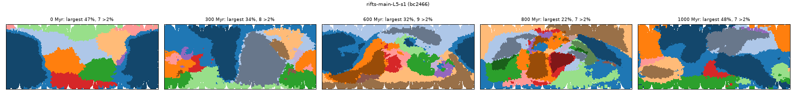
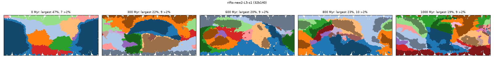
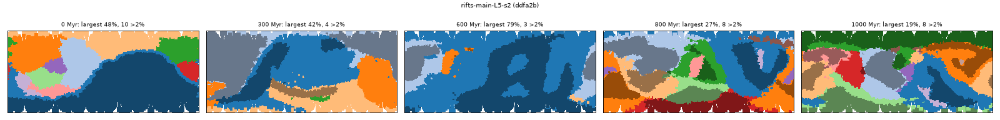
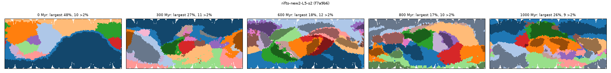
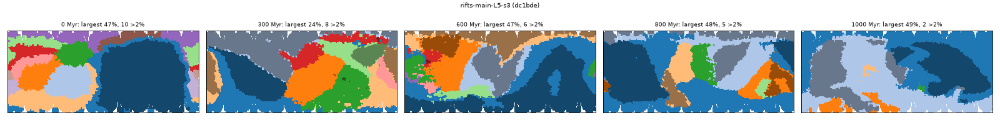
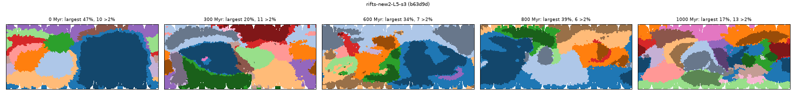
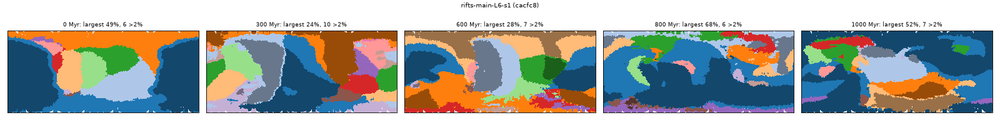
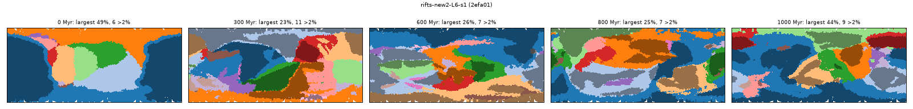
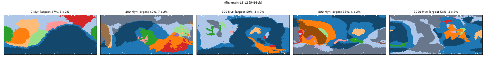
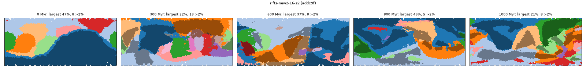

# Rifts that keep going, and triple junctions (PW-565, PW-952), 2026-10-28

Lane 22. Branch commits: see the end. Example runs are in the main store, so the viewer (port 8765) lists them.

## What suppressed late rifting (PW-565)
Measured with a harness that logs every stress test of every plate (`riftdiag.py`, scratch; same random draws, so the
run is unchanged), L6 seeds 2 5 7 and L5 seeds 1 2 3, 1 Gyr, main's code:

1. **The settle clock was restarted on the wrong plate.** `events.split` set `formed = t` on both the new plate and
   the plate it came from, and `maybe_rift` skips a plate for `settle_time` (30 Myr) after `formed`. Margin
   subduction (old floor breaking off a passive margin) is a split too, and it happens more as the floor ages
   (0-3 per 200 Myr early, 8-16 per 200 Myr after 600 Myr on L6). Each one restarted the clock of the big plate it
   broke off from. Result: the **largest plate was not stress-tested at all on 40-85% of steps** after ~400 Myr
   (L6 seed 2: 70-84% of steps in 600-1000 Myr), and stress rifts fell from ~13 to ~5 per 200 Myr. A feedback:
   fewer rifts, older floor, more margin subduction, more skipped tests.
   Fix: only the new plate waits; the plate a piece left keeps its clock.
2. **The size factor was damped below its own physics.** `stress_cut` judges a cut by the halves' speed
   difference times `(area / stress_min_plate)^(1/4)`, with the comment "the pull on each half grows with its
   area, the rock resisting it with the cut's length". The halves' speeds are force / drag and drag ~ area, so the
   stress across the cut is the speed difference x area / length ~ speed difference x sqrt(area): the exponent
   that reasoning gives is 1/2, and "gently" 1/4 was a damping. With only fix 1, L6 seed 5 still grew a plate of
   70-95% (by sutures) whose halves barely moved apart (effective opening -5..+2 cm/yr against the 2 cm/yr
   threshold) for ~60 Myr. Fix: exponent 1/2.

Ruled out on the way: strength growing with time (mean strength along the cuts 0.85-0.98 throughout), warm mantle
fading (the plate's mean anomaly varies -1..+0.2 with no trend), cuts blocked by the no-sliver rule (no admissible
cut on 0-36% of tests, no trend), mantle heat (heat_start 1: constant).

| L6, 600-1000 Myr | largest plate (mean) | plates > 2% | stress rifts per 200 Myr |
|---|---|---|---|
| seed 2 main | 0.50 | 4.5 | 13-8-2-7-5 |
| seed 2, fix 1 only | 0.30 | 8.0 | 13-16-8-13-12 |
| seed 2, fix 1 on rift splits only (margin subduction no longer resets) | 0.35 | 7.0 | 13-6-14-12-7 |
| seed 2, fixes 1+2 + triple junctions | 0.32 | 6.6 | 17-16-8-9-8 |
| seed 5 main | 0.44 | 5.7 | 13-18-10-7-5 |
| seed 5, fix 1 only | 0.53 | 4.3 | 18-17-8-7-2 |
| seed 5, fix 1 + triple junctions | 0.45 | 6.0 | 15-15-2-6-3 |
| seed 5, fixes 1+2 + triple junctions | 0.22 | 9.7 | 18-13-14-16-14 |
| seed 7 main | 0.51 | 5.0 | 11-15-9-5-4 |
| seed 7, fix 1 + triple junctions | 0.26 | 8.3 | 12-13-11-14-12 |

## Triple junctions (PW-952)
`events.triple_rift`: when a new plume's head arrives under a continent on a plate of at least 5% of the surface,
it cracks the plate along three wandering arms ~120 degrees apart (jittered 12 degrees), with odds
`triple_odds` (0.5) / the rock's strength at the plume (at most 1; a plume swell weakens it, a craton resists).
Each arm fails with odds `aulacogen_odds` (0.3): one failed arm leaves an aulacogen and the plate splits in two
along the other two arms; two failed arms split nothing (logged as an `aulacogen` event). Every piece must hold
at least 10% of the plate and no continental sliver; of 4 arm geometries the first that qualifies is used.
Logged as a `rift` event whose text names the triple junction. Literature: Burke & Dewey 1973, "Plume-generated
triple-junctions: key indicators in applying plate tectonics to old rocks", J. Geol. 81:406-433 (read 2026-10-29,
PDF in docs/references/tectonics/: rifts at about 120 degrees, abstract p. 406; of their 45 selected junctions, 32
spread on two arms with the third failed, 3 on all three, 5 on none, 5 too young to tell, p. 426; plumes rift
"especially" lithosphere at rest over them, p. 429); Afar and the Benue trough are the standard examples. Against
those counts the independent 0.3 per arm gives too many three-way splits (34% against 3 of 40); see the inbox
draft draft-aulacogen-odds-burke-dewey.md. The odds are a judgement: most of the big
continental flood basalts of the last 300 Myr came just before a breakup (CAMP, Karoo-Ferrar, Parana-Etendeka,
Deccan, North Atlantic, Afar), some didn't (Siberia, Emeishan, Columbia River).
In the examples: 0-3 triple junctions per 200 Myr per run, so they add breakups without dominating.

## Example runs (1 Gyr, default params)
Names in the viewer's run list. `main` = main at bfda8e67, `new2` = this branch (all three changes).

| run | id | largest plate (%) at 0, 100, ... 1000 Myr | plates > 2% | mean largest 600-1000 | >2% 600-1000 | stress rifts / triple per 200 Myr |
|---|---|---|---|---|---|---|
| rifts-main-L5-s1 | bc2466 | 47 30 58 34 25 26 32 50 22 61 48 | 7 10 6 8 8 10 9 6 7 6 7 | 43.0 | 7.2 | 13-10-10-9-6 / - |
| rifts-new2-L5-s1 | 32b140 | 47 15 55 22 19 17 20 44 23 21 19 | 7 10 8 9 9 9 9 10 10 9 9 | 23.0 | 8.9 | 17-13-11-12-16 / 2-2-0-0-1 |
| rifts-main-L5-s2 | ddfa2b | 48 21 49 42 24 40 79 40 27 37 19 | 10 9 6 4 9 6 3 6 8 6 8 | 30.8 | 6.7 | 12-6-7-10-9 / - |
| rifts-new2-L5-s2 | f7a9b6 | 48 22 48 27 20 42 18 19 17 15 26 | 10 11 7 11 10 8 12 10 10 12 9 | 20.0 | 10.6 | 15-14-18-16-12 / 1-0-3-0-1 |
| rifts-main-L5-s3 | dc1bde | 47 28 70 24 26 38 47 17 48 36 49 | 10 8 5 8 11 9 6 8 5 4 2 | 42.9 | 4.7 | 11-13-9-6-4 / - |
| rifts-new2-L5-s3 | b63d9d | 47 19 45 20 18 27 34 20 39 34 17 | 10 11 6 11 10 10 7 10 6 11 13 | 26.1 | 9.5 | 12-17-18-9-15 / 1-0-1-0-2 |
| rifts-main-L6-s1 | cacfc8 | 49 16 57 24 43 41 28 37 68 20 52 | 6 10 5 10 7 9 7 7 6 11 7 | 38.4 | 7.4 | 12-11-6-7-7 / - |
| rifts-new2-L6-s1 | 2efa01 | 49 34 31 23 18 26 26 27 24 25 44 | 6 9 8 11 10 9 7 8 7 8 9 | 28.5 | 8.6 | 17-15-11-10-12 / 0-0-1-2-0 |
| rifts-main-L6-s2 | 9496cb | 47 22 50 40 29 52 59 40 38 50 54 | 8 10 9 7 5 3 4 5 4 5 4 | 50.6 | 4.4 | 13-8-2-7-4 / - |
| rifts-new2-L6-s2 | addc9f | 47 14 54 22 22 25 37 26 49 32 21 | 8 12 8 13 10 9 8 7 5 8 8 | 30.3 | 6.8 | 17-16-8-9-8 / 0-1-0-0-0 |

Mean over the five pairs, 600-1000 Myr: largest plate **41% -> 26%** (Earth ~20%), plates over 2% **6.1 -> 8.9**
(Earth ~8). Every run still starts with a ~47% plate (the starting supercontinent's) and has one at 45-55% around
200 Myr (its first reassembly); late peaks of 44-57% remain for a few tens of Myr after big sutures.

Plate maps (plates coloured by size rank, continents darker), main then branch:

## Side effects
- **Continents ~1-2 km thinner, ~1-3 points more of the surface.** More continental rifting lays more thin margin
  crust (12-18 km) than subduction erosion (the area thermostat) removes. L6 mean continental crust at 1 Gyr:
  seed 1 33.5 -> 31.6 km, seed 2 32.6 -> 31.5 km; continent 42 -> 42-45%. L5 at 400 Myr (seeds 1-4): main
  29.6-31.6 km, branch 27.7-29.4. With triple junctions off it is ~main's (seed 2 30.1, seed 1 31.2), but seed 2's
  extra thinning comes from a run of ordinary continental stress rifts at 250-400 Myr, not from a triple split, so
  it is the sustained rifting as a whole. This fails the slow envelope `test_land_and_crust[2]` (27.7 km < 28; L5
  seed 2, 400 Myr). Not loosened; a needs-decision draft (draft-rifting-thins-continents.md).
- Ocean floor mean age (600-1000 Myr) on these seeds: no clear change (both 45-85 Myr, noisy), so PW-565's
  floor-age criterion is not shown met by these runs.

## Paired pass rate (L6, 1 Gyr, 2 rolls x 18 draws)
v1-finish-16's 18 L6 draws with +0.0005 and +0.001 added to every climate_offset (`paired.sh`), main at bfda8e67
against this branch at a526fe7c; pass = bar + checks at the finish moment (`fmtally.py`, hellhouse-only bar).

| roll | main | branch | main icebox | branch icebox | hellhouse |
|---|---|---|---|---|---|
| +0.0005 | 17/18 | 15/18 | 6/18 | 5/18 | 0 / 0 |
| +0.001 | 14/18 | 16/18 | 5/18 | 3/18 | 0 / 0 |
| pooled | **31/36** | **31/36** | 11/36 | 8/36 | 0 / 0 |

Paired: both pass 27, main only 4, branch only 4, neither 1. The branch's four failures: three too warm at the
finish moment (+5.8, +6.8, +9.7 C), one too icy (37% land ice); main's: two warm, three cold (29-40% land ice or
-5.8 C). The branch runs a little warmer: over 600-1000 Myr its CO2 source is x1.24 (more ridge: more new floor
outgassing), the weathering sink x1.20, land 33.5 -> 31.3% of the surface, mean dT +0.46 -> +1.15 C. No SIM SUSPECT.

## Scorecard (`tools/scorecard.py`, L6 seeds 1 2 at 1 Gyr; main = the line before, ae5ec1c3)
| seed | largest plate at 1 Gyr (max over run) | plates > 2% | land % | largest landmass % | ocean age | peak m |
|---|---|---|---|---|---|---|
| 1 main | 52.0 (68.3) | 7 | 34.2 | 19.6 | 62.3 | 6896 |
| 1 branch | 43.7 (43.7) | 9 | 29.7 | 6.9 | 54.1 | 5976 |
| 2 main | 53.9 (59.2) | 4 | 32.1 | 15.7 | 58.3 | 7315 |
| 2 branch | 21.0 (54.3) | 8 | 32.2 | 10.3 | 57.9 | 4097 |

Seed 1's land falls to 29.7% and its largest landmass to 6.9% at 1 Gyr (more, smaller continents, thinner crust:
see Side effects); peaks are lower on both (single moments, noisy; PW-846 watches mountain heights).

## Harness
- `platemaps.py`: maps and the plate-share line per run (needs `uv run --with matplotlib`, `PLANET_DATA` = main
  checkout).
- `paired.sh CODE_DIR PREFIX ROLL...`: v1-finish-16's 18 L6 draws per roll from a code snapshot, cap 8 sims and
  40 GB; tally with `docs/review/base-climate/v1-finish-16/fmtally.py`.

## Commits
- a526fe7c: the three model changes, test, goldens, harness.
- the next commit: this page, plate maps, scorecard line, drafts.
