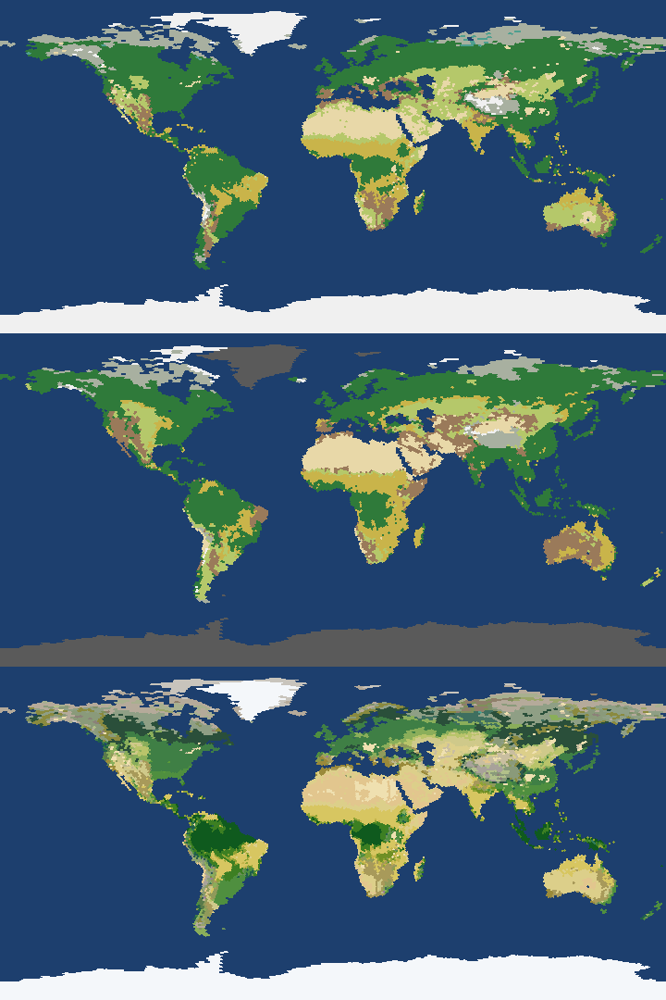
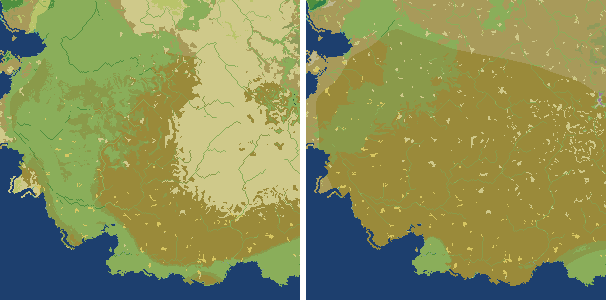

# Vegetation batch, 2026-10-16 (PW-234, PW-231, PW-205, PW-220)

(The first sections are the batch as first reported; the owner's decisions and the sclerophyll follow-up are at the end, and the overview's numbers are the follow-up's.)

Branch: worktree-agent-a66428276dd41ac91. Earth world: `tools/earth_world.py --level 6` on this code (L6, soils on: GLiM rock, LGM ice). All numbers from `tools/veg_check.py` and `tools/soil_check.py`; "obs" = observed climate, "model" = the model's own climate.

## What changed and why

**PW-234, fire fuel age** (`vegetation.fire_rate`, `SLOW_FUEL`). Cause: fuel was the equilibrium fine-litter stock against FUEL_MIN 250 g C/m², so a low-NPP maquis (NPP ~230) never had enough fuel, and raising its litter made it burn at a savanna's rate and turn to grass. Fix: shrubs keep their fine litter as dead fuel in and under the crown, decaying at half the litter's rate (fine woody debris, Harmon et al. 1986), and fire is a renewal process: the years a burned patch needs to rebuild its fuel past FUEL_MIN plus the wait for a fire year (1 / (weather × fuel factor)). Grass and leaf litter are ready every year, so grass and savanna cells burn exactly as before. Sclerophyll shrubs (SclS) now survive 90% of fires (was 80%): resprouters keep their roots and space, as grass (0.95) and savanna trees (0.93) do. Sensitivity (obs, before PW-231): with SclS survival 0.8 the decay ratio gives maquis 72 / 65 / 34 / 15 cells at 1.0 / 0.5 / 0.35 / 0.2 (base 84): any extra fire turns the scrub to grass; with 0.9 survival, 72 / 126 / 117 / 79. 0.5 is the middle of the literature range for twigs vs leaves, not the best score.

**PW-231, C3/C4 crossover** (`potential`'s `c4_share`, `_q3`, `QY_CROSS`). Cause, found by looking at the competition terms in the 25-30° S grasslands: the two grasses were separate Lotka-Volterra types of one height (C_SAME 0.7), and a stand's cost scales with its own NPP below 600 g C/m², so their growth rates were nearly equal (1.80 vs 1.82 /yr where C4's NPP was 15% higher) and their shares sat near 50/50 wherever both were viable (histogram of C4 shares: most cells 0.3-0.7). The crossover followed C4's envelope, not its productivity, which is why temperature nudges didn't move it. Fix: C3 and C4 grasses are one grass layer whose C4 share is the share of its growth in months where C4 grows better (Still et al. 2003's C4 fraction after Collatz et al. 1998), so summer-rain grasslands are C4 even with cool winters. C3 grass's efficiency now follows its quantum yield, (Ci − Γ*)/(Ci + 2Γ*) (Farquhar et al. 1980; Γ* from Bernacchi et al. 2001; Ci = 0.7 Ca), anchored to C4 grass's efficiency at a 22 °C month at 350 ppm (Collatz's criterion): at 12-15 °C it is within 4% of the old value, at 25-30 °C 10-20% lower. On today's Earth the quantum yield alone moves nothing (the split does); it gives the crossover its CO₂ dependence (the run's CO₂ index), replacing the generic C3 nudge for grass.

**PW-205**: no code. C4 crossover and burned share follow from 1-2; boreal types are in range (16.6 / 14.4 Mkm²); the southern Amazon fringe is the start state of a world without history (owner decision A, keep: table below).

**PW-220**: smalls2's fixes (heath needs P/PET ≥ 0.5, tropical-led forests in tropical climates, boreal woodland names need a subarctic climate) hold on a new L7 world (run a1d3b9 @ 1000 Myr from its keyframe): 0 heath cells under 400 mm, 0 lichen woodland with a coldest month above −2 °C; the only temperate deciduous/mixed forest within 8° of the equator is two cells on 1500-1800 m highlands with a coldest month of 14-15 °C (below TrBE's 15.5 °C). Maquis now burns (below).

## Earth (L6), before → after

| | obs before | obs after PW-234 | obs after PW-231 | model before | model after |
|---|---|---|---|---|---|
| potential-vegetation agreement | 60.6% | 59.9% | **59.5%** | 40.3% | **40.0%** |
| land NPP, Pg C/yr (~56) | 57.6 | 57.1 | 57.0 | 42.7 | 42.4 |
| vegetation carbon, Pg C | 522 | 520 | 521 | 350 | 347 |
| burned area, Mkm²/yr (GFED ~4-5) | 4.6 | 4.4 | 4.3 | 2.9 | 2.7 |
| share in savanna and grassland (~70-80%) | 92% | 81% | **79%** | 94% | 72% |
| burned in shrubland types, Mkm²/yr | 0.10 | 0.57 | 0.60 | 0.06 | 0.63 |
| forest (trees ≥ 60%), Mkm² | 48.1 | 46.2 | 46.2 | 46.5 | 43.9 |
| shrubland group, Mkm² | 3.2 | 7.8 | 8.8 | 5.0 | 12.5 |
| savanna and tropical grassland, Mkm² (~20) | 20.2 | 19.1 | 18.6 | 22.5 | 21.4 |
| boreal, Mkm² (12-17) | 16.9 | 16.7 | 16.6 | 14.5 | 14.4 |
| Mediterranean cells (Cal/Chile/Med/Cape/SW Aus) | 11/8/58/4/16 | 14/8/79/4/17 | 14/8/81/4/17 | 2/0/21/0/0 | 4/0/24/0/0 |
| maquis cells / median fire return | 84 / never (54% of them fire-free) | 126 / 24 yr | 131 / 24 yr | | |
| Mediterranean types' fire return, median (IQR) | none in half | 28 (15-79) yr | 28 (15-81) yr | | |
| C4 share < 50% from (N, S) (obs ~30-35) | 30, 25 | 30, 25 | **35, 40** | 30, 30 | **35, 40** |

Soils (`soil_check.py`, obs / model): agreement 44.1 → 44.1% / 32.4 → 32.5%; soil carbon 1707 → 1675 / 1415 → 1392 Pg C (less grass); peat unchanged.

Drops, honestly: agreement −1.1 / −0.3 points; forest −1.9 / −2.6 Mkm²; the shrubland the model adds is mostly where potential vegetation has savanna or grassland (Botswana/Zambia grassland and North American short-grass → "dry sclerophyll scrub", some Chaco / N India forest → thicket); the C4 crossover overshoots in the south (40° S: the 35-40° S band has only 35 cells, Chile and S Australia at ~50%).

*Observed climate after the batch: model groups, potential vegetation, model types.*

## L7 world and zoom (run a1d3b9 @ 1000 Myr, from its keyframe)

The ticket's world 351f32 and zoom 58c0ac no longer exist, so: world from the same keyframe built with the old code (dd66bf) and the new (7d3c84), and a zoom of each at 32.0, −80.5 (600 km @ 2 km; a maquis region whose cells were fire-free before; the after zoom on the code merged with main, which gives zooms the soils). Outputs deleted after the batch.

| | before | after |
|---|---|---|
| maquis cells (world) / fire-free | 81 / 89% | 127 / 46% |
| maquis fire return, burning cells, median | 139 yr | 49 yr |
| dry sclerophyll scrub cells | 1980 | 4672 |
| heathland cells (median rain) | 5 (1820 mm) | 71 (996 mm) |
| mean tree cover / SclS cover / C3 grass cover | 40.4 / 4.9 / 8.3% | 37.8 / 10.8 / 2.9% |
| zoom: maquis share of land / burning / median return | 17% / 20% / 22 yr | 57% / 83% / 48 yr |
| zoom: trees | 17.4% | 7.8% |

*Zoom at 32.0, −80.5 (600 km @ 2 km), named types, before (left) and after (right): the woodland and steppe of the summer-dry hills become maquis (olive) and, to the north, dry sclerophyll scrub.*

The maquis now burns and stays scrub, as PW-234 and PW-220 asked; but with SclS the most fire-tolerant woody type, its own fuel kept trees and grass out wherever it was viable, and scrub spread into steppe, savanna grassland and woodland (the table above, "after" column: 12% of the world's land changed type).

## Follow-up: sclerophylls need a dry summer in dry climates (owner decision C; superseded below)

SclS stood for every warm evergreen shrub, so its envelope (coldest month −5..18 °C, GDD5 ≥ 1500) let it into summer-rain semi-arid lands, where the real shrubs are raingreen thorn shrubs and the rain feeds C4 grass. Hard sclerophyll leaves are a summer-drought adaptation, so now in dry climates (P/PET < 0.65, classify's own dry-sclerophyll threshold) SclS can't establish where more than half the year's rain falls in the warm half-year. Humid climates keep it either way: there it also stands in for the laurel forests' evergreen understory, and without it (first try: the rain rule everywhere) grass invaded the gaps of humid summer-rain forests and burned them (L7 world tree cover 40.4 → 31.0%, Earth forest 48.7 → 45.5 Mkm²). SclS survival 0.9 and the fuel-age fix stay.

Numbers re-measured on the code merged with main (a new Earth world, so the old code's numbers moved a little: obs agreement 61.4%, model 40.8%):

| Earth (obs / model) | old code | B (survival 0.8) | first try (rain rule everywhere) | **C (dry climates only)** |
|---|---|---|---|---|
| agreement | 61.4 / 40.8% | 60.8% / – | 61.3% / – | **61.5 / 40.0%** |
| land NPP, Pg C/yr | 58.9 / 44.4 | 59.2 | 60.2 | 59.7 / 45.6 |
| burned area, Mkm²/yr (share in grassy types) | 4.8 (92%) / 3.3 (94%) | 5.1 (89%) | 5.6 (91%) | 5.4 (88%) / 4.1 (83%) |
| forest (trees ≥ 60%), Mkm² | 48.7 / 48.0 | 46.5 | 45.5 | 46.8 / 44.8 |
| Mediterranean cells | 96 / 22 | 85 | 127 | **127** / 28 |
| Mediterranean types' fire return (median, IQR) | none in most | 39 (21-360) yr | 26 (14-81) yr | 26 (14-81) yr |
| Botswana/Zambia (213 cells): sclerophyll or thicket | 6 | 50 | 0 | 9 (149 tropical grassland) |
| Chaco (116 cells): sclerophyll or thicket | 6 | 9 | 1 | 11 |
| US plains (141 cells): sclerophyll or thicket | 1 | 8 | 0 | 2 |
| C4 share < 50% from (N, S) | 30, 25 / 30, 35 | 35, 40 | 35, 40 | 35, 40 / 35, 40 |

Soils (obs / model): agreement 44.4 / 32.9%.

| L7 world (run a1d3b9 @ 1000 Myr, keyframe) | old code | after PW-234/231 | B | **C** |
|---|---|---|---|---|
| maquis cells / fire-free / median return | 81 / 89% / 139 yr | 127 / 46% / 49 yr | 88 / 56% / 45 yr | **126 / 46% / 49 yr** |
| Mediterranean types (cells) | 91 | – | 92 | **132** |
| dry sclerophyll scrub / temperate thicket cells | 1980 / 602 | 4672 / – | 2940 / 1515 | **656 / 1910** |
| mean tree cover | 40.4% | 37.8% | 37.0% | **37.1%** |
| land that changed type | – | 12% | 10% | 12% |

| Zoom 32.0, −80.5 (600 km @ 2 km) | old code | C |
|---|---|---|
| maquis share of land / burning / median return | 23% / 4% / 41 yr | 57% / 83% / 48 yr |
| tree cover | 17.0% | 7.8% |

C does what it should in summer-rain dry lands: the mallee/mulga belt is back to steppe and C4 grassland (656 cells, fewer than the old code's 1980, which had sclerophylls in summer-rain steppe too), Botswana/Zambia is tropical grassland again, and the Mediterranean cells stay. Not fixed, because C doesn't touch them: (1) humid warm temperate forest and woodland turning into "temperate scrub and thicket" (L7: 602 → 1910 cells; Earth Chaco 6 → 11), the fuel-age shrub-fire feedback where SclS is the understory; (2) the zoom's summer-dry hills (a winter-rain climate, where SclS belongs) going from woodland and steppe to maquis, trees 17 → 8%. Real Mediterranean hills at ~480 mm are maquis, garrigue and evergreen-oak woodland, so (2) is arguable; (1) is explained and resolved in the second follow-up below.

*Zoom at 32.0, −80.5, named types: old code (left), C (right). Woodland and steppe on the summer-dry hills become maquis (olive) and Mediterranean evergreen woodland.*

## Second follow-up: why humid forest turned to thicket; the humid exemption removed

The coordinator asked why "temperate scrub and thicket" tripled on the L7 world under the exemption (602 → 1910 cells) and whether the exemption (humid climates keep SclS whatever their rain season) has a physical reason. It doesn't, and it is gone: SclS now needs at most half the year's rain in the warm half-year everywhere (a summer-drought plant).

**Cause.** The 1041 L7 cells that went from forest or woodland to thicket are monsoon climates: 91% of the rain in the warm half-year (median), ~6 fire-weather months (fire season 0.48), 940 mm, P/PET 0.81. The run's own keyframe, which a keyframe world starts from, has **no trees in 93% of them**. The old world code grew a forest there from seed anyway, because an open start had too little fuel to burn. With the shrubs' slow fuel the open start stays open and burns every ~14 yr, so SclS thicket won. Fuel age doesn't make forest unstable: from a closed-forest start (0.9 tree cover) the same cells stay forest (68% trees, 85% fire-free) with or without the rain rule. Forest and open land are both stable there, and history decides, as the model intends. The exemption had two effects. In these monsoon cells it put sclerophyll thicket where a summer-rain, fire-kept open landscape should be grass savanna. In 3506 humid summer-rain cells that were also open in the keyframe (83% treeless), SclS was the only warm shrub, so it shaded out the grass and let a forest grow. Soil fertility can't separate the two (median 0.22 in the thicket cells against 0.24 on all land), so the rule isn't tied to it.

**Result** (L7 harness: the keyframe world's vegetation inputs, rerun; cell means):

| L7, run a1d3b9 @ 1000 Myr | old code (close: SLOW 1, survival 0.8, no rule) | with humid exemption | **rain rule everywhere** |
|---|---|---|---|
| temperate scrub and thicket cells | 549 | 1908 | **242** |
| dry sclerophyll scrub cells | 2458 | 684 | **675** |
| maquis / Mediterranean types | 67 / 82 | 131 / 138 | **128 / 133** |
| forest cells (trees ≥ 60%) / mean tree cover | 22567 / 44.0% | 20457 / 39.6% | **17460 / 33.5%** |
| world vs the run's keyframe tree cover (25.0%): mean difference | 22.3 pts | – | **12.4 pts** |
| keyframe-open cells (< 10%) that the world makes forest | 8020 of 31569 | – | **3204** |
| from a closed-forest start: forest cells / tree cover | – | 26556 / 51.6% | 26523 / 51.4% |

The world's forest falls, but it now follows its run's history about twice as closely. The old world grew forest on a quarter of the land the run had as open.

| Earth (fresh world after the last merge), obs / model | old code | **now** |
|---|---|---|
| agreement | 62.1 / 41.6% | **62.1 / 40.5%** |
| land NPP, Pg C/yr | 59.8 / 45.0 | 61.0 / 47.7 |
| burned, Mkm²/yr (share in grassy types) | 4.9 (92%) / 3.5 (94%) | 5.7 (91%) / 4.9 (95%) |
| forest (trees ≥ 60%), Mkm² | 49.9 / 49.2 | 46.6 / 42.2 |
| savanna and tropical grassland, Mkm² | 19.8 / 23.9 | 22.2 / 30.2 |
| Mediterranean cells; Mediterranean types' fire return | 100 / 24; never (median) | 127 / 33; 24 yr |
| Botswana/Zambia, Chaco, US plains: sclerophyll/thicket cells | 6, 6, 1 | 0, 1, 0 |
| C4 share < 50% from (N, S) | 30, 25 / 30, 35 | 35, 40 / 35, 40 |

On Earth (no history: the young-woodland start, decision A) the summer-rain margins without a shrub stage go to savanna rather than forest. The obs agreement doesn't move; the model climate loses 1.1 points and 7 Mkm² of forest, mostly where its own climate is too dry. The burned share in grassy types is back at ~91% (GFED ~70-80%), because shrubland fire was mostly the summer-rain thicket that is now grass.

**The zoom at 32.0, −80.5 is genuinely Mediterranean.** Its cells (n = 86 within ~300 km) are 73% Köppen Csa: 500 mm a year, 70% of it in the cool half-year (monthly rain from 67 mm in January to 15 mm in July), warmest month 26.7 °C, coldest 8.8 °C, P/PET 0.45, fire season 0.53. At ~500 mm with a hot dry summer, maquis or chaparral with evergreen woodland is the expected cover, so its 57% maquis (burning every ~48 yr) and 8% trees are right. The rain rule doesn't touch it.

## Start of a world without history (owner decision A, keep)

The southern Amazon fringe (18-7 S, 65-45 W) is savanna in 57 of the 135 cells that potential vegetation calls forest (31 of 46 on the Brazilian shield). Forest and savanna are both stable there, so the start decides. Earth and `generate` worlds start from `vegetation.START` (trees 0.4, herbs 0.3). Observed climate, code before the follow-up:

| start (trees, herbs) | agreement | forest Mkm² | savanna + trop. grass | burned Mkm²/yr | Amazon fringe forest / savanna | Med. cells | NPP |
|---|---|---|---|---|---|---|---|
| 0.4, 0.3 (kept) | 59.5% | 46.2 | 18.6 | 4.3 | 77 / 57 | 124 | 57.0 |
| 0.8, 0.1 (closed forest) | 59.0% | 55.6 | 10.5 | 2.3 | 123 / 11 | 89 | 51.9 |
| 0.1, 0.6 (grassland) | 59.4% | 45.7 | 19.1 | 4.4 | 69 / 65 | 124 | 57.3 |

## Follow-ups (inbox drafts)
- `draft-veg-boreal-fire-weather.md` (boreal fire return ~380 yr vs ~50-200)
- `draft-world-shore-cells-stored-at-0m.md` (a test fragility the changed run trajectory exposed)

After merging main's polar-climate bundle (a fresh Earth world): obs / model agreement 62.3 / 40.9%, land NPP 60.6 / 46.2 Pg C/yr, burned 5.4 / 4.2 Mkm²/yr (88 / 83% in grassy types), Mediterranean cells 127 / 33, C4 crossover 35 / 40° N / S on both; superseded by the second follow-up's table.
