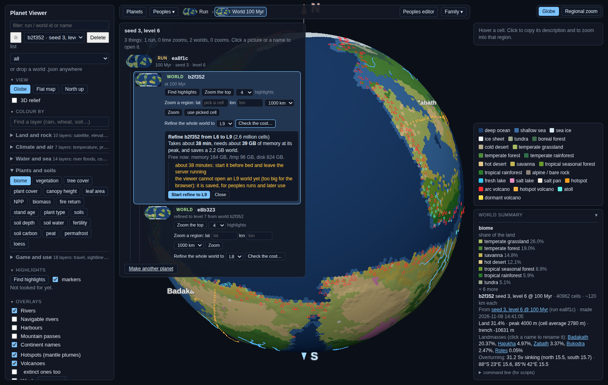

# Refine from the viewer (PW-1438, lane 227)

## In plain words

You can now refine a world to L8 or L9 from the viewer, without the command line. The viewer tells you what it will
cost first: how long it takes, how much memory it needs, and how big the file will be. It refuses to start when the
machine does not have the room, or when another refine is already queued or running. While the refine runs you see a
progress bar, the stage it is on, and roughly how long is left. When it finishes, the refined world opens on the globe.
Since PW-1209 (lane 229, [binary-layers.md](binary-layers.md)) an L9 world opens too, slowly (about 10-20 s).

The refine runs on the server's usual job queue, the same one that makes zooms, time zooms and finished worlds. There is
no second job runner.

(The screenshot shows a small test world at L6, so its menu offers L9 and the cost box shows L9's warnings. The world
under it, e8b323, is the L7 refine made through this control during testing.)

## How Daniel uses it

1. Open the world you want to refine on the globe. It must be a world made from a run: a finished world, or a world
   at a moment of a run.
2. Click **Family ▾** at the top right of the bar. The world is highlighted in the tree.
3. Under it, at **Refine the whole world to**, pick **L8** or **L9**, then click **Check the cost…**.
4. A box shows the time, the peak memory, the file size, and how much memory, /tmp and disk are free now. Amber lines
   are things to know: L9 takes about 38 minutes ("start it before bed and leave the server running") and cannot be
   opened in the viewer yet. Red lines are why it will not start.
5. If there is no red line, click **Start refine to L8** (or L9). The bar at the top and the Family drop-down show the
   progress, the stage, and "about N min left". **Cancel** stops it at the end of the stage it is in (see "Limits").
6. When it is done, an L8 world opens on its own. In the Family tree, the refined world sits under the world it came
   from, labelled "refined to level 8 from world …". In the bar at the top it is called "Refined world L8".

If you reload the page while a refine runs, the job carries on on the server, and the bar picks it up again by itself
(lane 229: `GET /api/jobs?type=refine`; the screenshot [refine-after-reload.png](refine-after-reload.png) is a fresh
page opened 15 s into an L8 refine).

## What it costs, and when it refuses

The cost comes from `refine.cost`. It is a fit to the two refines lane 104 measured from an L7 world
(`docs/review/refine-l8/report.md`):

| target | cells | time | peak memory | file |
|---|---|---|---|---|
| L7 (from an L6 world) | 164k | ~1.3 min | ~3.8 GB | ~0.14 GB |
| L8 | 655k | ~7 min (measured 4.5-10) | ~10.8 GB (measured 10.8) | ~0.56 GB (measured 0.44 + grid) |
| L9 | 2.6M | ~38 min (measured 38) | ~38.7 GB (measured 38.8) | ~2.2 GB (measured 1.76 + 0.37 grid) |

Time grows a little faster than the number of cells, because wave power does. Memory grows about in step with the cells.

It refuses to start (409 from `POST /api/refine`; the red lines in the box) when:
- another refine is queued or running: one at a time (`Jobs.active("refine")`);
- free memory (Linux MemAvailable) is below the expected peak plus 8 GB;
- /tmp has less than 40 GB free (/tmp is memory on the Threadripper; the house rule);
- the data disk has less than twice the file size free.

The same checks run again when the job actually starts. If memory went to other jobs while it waited in the queue, the
job fails at once with the reason and does not run.

## Tested

- `tests/test_refine_job.py` (7 tests, ~10 s): the cost fit against the measured refines; bad requests; refused for
  memory and for /tmp; one refine at a time (a second one gets 409 and names the running job; the estimate shows it as
  busy); the real path through the job queue (an L4 world refined to L5: every stage reported in order, the new world
  saved with `refined_from`, placed under its source in the family tree, and named by the next estimate as already
  made); cancel at a stage; the room checked again when the job starts. The heavy L8 and L9 refines were not run.
- By hand, on a server of my own (port 8791, 1 job, 4 threads, data root `exports/lane227/`, gitignored): an L6 world
  (run ea8f1c, seed 3, 100 Myr → world b2f352) refined to L7 through `POST /api/refine`. It took 67 s (estimate 1.3 min).
  The stages came in order: terrain, climate, waves (41 s, as expected the longest), tides, soils and plants, done. A
  second POST during it got "another refine is queued or running (job 1-66881): one at a time". The result, world
  e8b323, sits under b2f352 in the Family tree. The screenshot was taken by headless Chrome against that server.

## How it works (for the next lane)

- `GET /api/refine/estimate?world=&level=` → `api.refine_estimate`: cost, free memory, /tmp and disk, `refuse` and
  `warn` lists, `existing` (a world already refined from it at that level, from `refined_from` in the world index),
  `busy` (the running refine's job id).
- `POST /api/refine {world, level}` → `server.submit` checks the estimate, then queues
  `{type: refine, world, level, estimate_min}` (`estimate_min` gives the viewer its ETA before progress says much).
  `api.refine_job` checks the room again and calls `refine.refine_world` with a `progress` callback.
- Progress: `refine.STEPS` gives each stage's rough share of the time. The finish's stages come from a new `step`
  callback on `world.finish`. The stages there are only named, and the wave power and tides are now computed just
  before the layers dict instead of inside it, so outputs do not change. Each progress report is also where a
  cancelled job stops (`api.any_job`).
- The world index (`store._world_item`) now carries `refined_from`. `family.planets` parents a refined world under its
  source world.
- Viewer: `viewer/navigator.js` (`refineForm`, `refineBox`, `refineCost`, `eta`, and `follow`, which is split out of
  `start` so it can also attach to a running refine). The form shows on worlds from a run below L9.

## Limits

- **Cancel waits for the end of the stage.** Wave power is one long call: about half an L8 refine, and most of an L9
  one. Until it ends, the worker keeps its memory (inbox draft: refine cancel waits a stage).
- The memory check does not count what other running jobs (zooms, makes) will still take; it reads what is free now.
- An L9 world opens in about 10-20 s and takes ~4 GB of the browser's memory (PW-1209). Peoples on a refined world is PW-1265.
- A refine queued behind other jobs waits for a free worker like any job. With the server's default of 4 jobs at once,
  zooms and finishes still run beside it.
