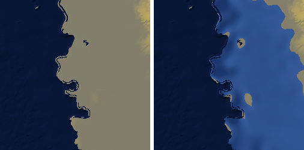
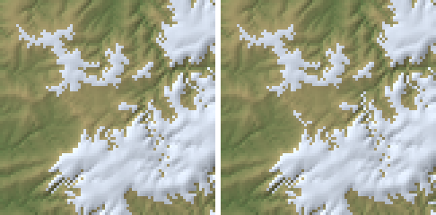
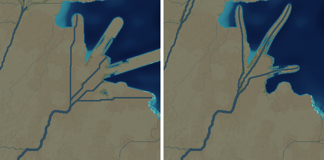
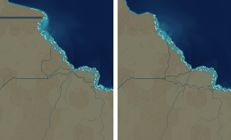

# Zoom batch 5: PW-356, 357, 124, 061, 116 (2026-10-16)

Measured as in pw298.md / batch4.md: world 592f2a (showcase L7 seed 3199 @ 380 Myr), its 8 highlight zooms plus
the plateau -48.48, 60.12, each built with zoom seeds 1-5 (`zoom.build` in memory). "Drops" are `stats.falls` of
kind `drop` >= 100 m; "inland" is `stats.inland_cell_mean_*`; "perched" counts river pixels (>= 100 m^3/s) with
land (< 30 m^3/s) within 2 px lying more than 30 m below every river pixel within 2 px of it (PW-124's metric).

## PW-356: the bed below the sea under grounded ice

Worlds store the true bed (PW-307); the zoom took a sub-sea bed under grounded ice at 1 m (the land view). The
terrain passes still build on that view (`zoom.land_world`, which replaces `zoom_world`): they take land as
ground above the sea (rivers graded to it, lakes, creep), and under a grounded sheet there is no subaerial
landscape for them to shape anyway. After the climate, the bed under the zoom's glaciers sinks by each coarse
cell's depth below the view (interpolated as the coarse heights are, then 12 smooth passes correcting each such
cell's iced pixels to the true bed's mean), and the ice thickens by as much. A load's dip or a marine basin is
hundreds of km wide, so a smooth offset is the right shape at the zoom's scale; the relief is the view's.

World 85922d (finished from time zoom 080df3 @ 950 kyr, sea level -101 m; 2564 cells on a sub-sea bed, -349 m
mean, to -1502 m), zoom -55, -80 (1000 km @ 4 km), seed 1; 48% of its pixels lie in such cells, 98% of them iced:

| | before | after |
|---|---|---|
| bed under the ice in those cells (mean; the cells' -476 m) | +15 m | **-452 m** |
| per full-ice cell: mean bed - true bed (p10 / p50 / p90) | +213 / +397 / +1086 m | **-7 / +1 / +6 m** |
| inland cell bias / RMS against the true bed (against the view before) | +14 / 17 m | **-1.5 / 12 m** |
| ice surface, water layer | | unchanged (max 0.0003 m) |

The remaining large cell errors are coastal cells with sea pixels in them (their sea floor is the coarse sea's).
Bare land in such a cell (0.0% here) keeps the view's ground above the sea. The 592f2a zooms have no such cells:
unchanged. Test: `test_marine_sheet_keeps_its_sub_sea_bed` (a synthetic marine sheet: no sea there, each cell's
bed within 15 m of -500 m, surface, ice outline and water identical to the land view's build).

*The bed (ice off) of zoom -55, -80 on world 85922d, before | after: under the marine sheet the bed lies 300-1300 m
below the sea (blue) instead of at ~1 m; the coast and the ice-free land are unchanged.*

## PW-357: tongues fed along their zone's margin

`glacier_flow` counted a tongue's run (GL_MAX_KM = 100 km) from where its biggest feeder left the accumulation
zone. A tongue running along the zone's margin, fed by it pixel after pixel, used up its 100 km there and was cut
at the cap still carrying the 3 km^3/yr GL_F_MAX flux. Now the run counts from the last pixel the zone itself
drains into: along the margin the tongue is the zone's edge (its excess over the cap lost along that margin, as
GL_F_MAX's rationale has it), and it ends where its melt has used up its flux.

The test massif of `test_zoom_ice` (900 km @ 3 km): the 8 biggest tongue ends carried 1.6-2.8 km^3/yr at runs of
97-99 km (6.0 km^3/yr in all cut by the cap); now every end has melted out (flux ~0; longest run 82 km). Ice on
ground with > 12 C summers 0.28% -> 0.47% of the ice (the test allows 0.5%: big maritime outlets do end in
rainforest), ice volume +0.6%. The 592f2a zooms: only the glaciated 49.32,37.38 moves (inland bias / RMS +1.3 / 54.9
-> +1.7 / 55.6 m; ice 30.0 -> 29.9% of the area; drops unchanged). Test: `test_tongue_along_the_zone_ends_by_melt`.

*The test massif's western margin (3 km pixels), before | after: tongues cut at the run cap now go on down
their valleys until they melt out.*

## PW-124: perched rivers (measured, not changed)

Per seed, over the 8 zooms: 41 perched river pixels (of ~15,000 river pixels), 4.8 of them > 100 m; 30 of the 41
on the arc zoom -9.35,-161.39 (4 km). Under ice: 0.4 (the ticket's first case is gone); beside other rivers: none
found. Every remaining case is on a designed-fall reach, whose course is pinned to the coarse polyline (plus ~5
levee-bound delta distributaries on the arc, perched by design):

1. at 4 km/px the banks are 2 px flat, then fall at 30 m/km (BANK_SIDE_GRAD), so land two diagonal pixels (11 km)
   off may lie 99 m below the river: side tributaries graded to the river below the reach's falls (the arc's ~30);
2. the pinned course runs along a valley side above a deeper fine valley (-2.22,-169.11 seed 4: 16 px, 115-160 m);
3. a lip's gorge beside the upper reach (49.32,37.38 seed 3: a 1704 m tread, the gorge at 1266-1308 m within 2 px),
   which is natural (Niagara's gorge beside its upper river).

Fixing 1-2 means either lowering each reach's staircase to the land beside it (tapered at its head, or the river
above gains an undesigned drop) or letting the pinned course move to the fine valley bottom where it lies lower
within the banks' width: a design choice for the designed falls, left on the ticket with these options.

## PW-061: delta branches and fingers

The fans are no longer small (PW-269 made the plains 70 km x (Q/1000)^0.35); what was left was their drawing:

- **Branches** were greedy D8 walks towards each goal with a little noise in the heading: ruler-straight channels in
  the eight directions (on a river-dominated delta the noise was damped to almost nothing). Each branch now follows
  a smooth curve to its goal, bowed to one side (~N(0, 12%) of its length, less on a river-dominated delta) with a
  wiggle of 15-35 km wavelength: still a walk of single steps (every step nearer the course's end, round the high
  ground and the other branches), but heading for a point 2 px ahead on the curve, so it runs in any direction. A
  split's two children leave it turned ~35 deg to their own sides (straight off if that is high ground); a branch
  joins another only where that leads on to the sea, not back up its own course (a loop); a branch, or a subtree,
  that never reaches the sea is taken back (its open end drained back into the delta, and `reroute` then dropped
  every distributary); no branch crosses ground (the smooth coarse surface) more than 30 m above its apex's.
  `reroute` now lets go of just a loop's pixels when a distributary laid out on an earlier network closes one, as
  it does for the falls' pinned courses.
- **Fingers** (the bird's foot) were straight strips of constant width out from the coarse mouth, each with a
  straight branch aimed at the coast pixel nearest its tip, which was often 100+ km along the coast when the
  finger pointed along it. Each finger now bends gently away from the fan's middle and wanders (the Mississippi's
  passes), narrows to half its width at the tip, and its branch enters it a tenth of the way out and follows its
  axis to the tip; a finger along a direction that runs on over land (more than 40% of its outer part) isn't built.

Zooms with deltas (seeds 1-5): drops and inland bias unchanged (4.97,-114.51: 0 / -1.9 m; 1.96,-70.44: 0.4 /
-0.1 m; the arc: 3.6 / +0.3 m).

| Zoom | mouths at sea, before | after | splits before | after |
|---|---|---|---|---|
| 4.97,-114.51 (two bird's feet, a wave delta) | 10.2 | 5.8 | 7.4 | 4.0 |
| 1.96,-70.44 | 4.8 | 5.0 | 4.0 | 3.4 |
| -9.35,-161.39 (arc, six tidal deltas) | 15.8 | 22.6 | 13.4 | 18.0 |

The bird's feet lose the mouths of branches that had crossed the plain to a far coast (the ticket's misplaced
mouths): they reach the sea through their fingers now, 1-3 of up to 4 fingers getting a channel (the others are
cut off by the trunk's own course or high ground: inbox draft). On the arc the perched metric (PW-124) rises from
33 to 45 river px per seed (> 100 m: 1.4 -> 1.2): more distributaries, some of them 30-90 m above the plain beside
them, where a pinned branch's course crosses higher ground further down and the landscape pass lifts it all
(inbox draft). `test_coast.test_delta_types_differ` holds (river reach 0.45 R beyond the coast, tide 0.34 R; tide 4
mouths, wave 2). Tests: `test_delta_fingers_curve_and_build_out_into_the_sea`.

*The 39,700 m^3/s bird's foot of zoom 4.97,-114.51 (2 km pixels, seed 1), before | after: straight strips and
eight-direction channels (one crossing 150 km of plain to the south-east coast) | curved fingers each with its
channel.*

*Its wave-dominated delta: a channel along a row of pixels | channels that wander.*
