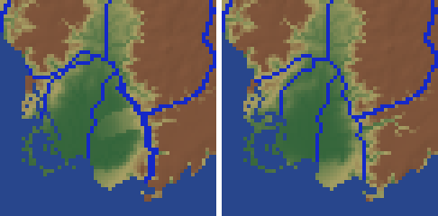
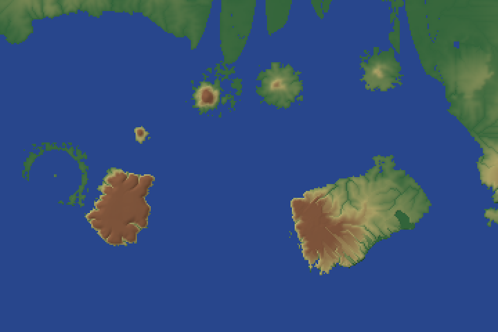
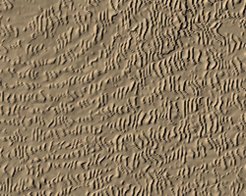

# Zoom batch 6: PW-124, 363, 362, 060, 177 (2026-10-16)

Measured as in batch4.md / batch5.md: world 592f2a (showcase L7 seed 3199 @ 380 Myr), its 8 highlight zooms plus
the plateau -48.48, 60.12, each built with zoom seeds 1-5 (`zoom.build` in memory). "Drops" are `stats.falls` of
kind `drop` >= 100 m; "inland" is `stats.inland_cell_mean_*`; "perched" counts river pixels (>= 100 m^3/s) with
land (< 30 m^3/s) within 2 px lying more than 30 m below every river pixel within 2 px of it (PW-124's metric).
Baseline (main at the batch's start): 9.8 drops per seed (4-14), perched 56.2 per seed (> 100 m: 5.0), the arc
zoom -9.35,-161.39 47.4 of them.

## PW-124: perched rivers on designed-fall reaches (tried, not merged)

The coordinator's pick, option B: let a falls reach's pinned course go to the fine valley bottom. Tried: from a
third of the way through the landscape pass, a course pixel is unpinned where active land off the course within
the banks' width (BANK_KM, at least 2 px) lies more than T below it; `place_falls` follows the river wherever it
runs. Near a lip the land beside the plateau is the fall's own foot, so the course stays pinned within the banks'
width + 3 px of each lip and its gorge (without that the river left the plateau 2-5 px above the lip: the arc's
693 m lip of seed 3 became a 684 m "drop").

| | drops / seed | perched / seed | > 100 m |
|---|---|---|---|
| main | 9.8 | 56.2 | 5.0 |
| B, T = 30 m | 10.8 | 50.8 | 3.8 |
| B, T = 100 m | ~10.6 | 53.4 | 2.8 |

Case 2 of batch 5 (-2.22,-169.11 seed 4, the course along a valley side above a deeper fine valley) goes
outright (16 -> 0 px: the river takes the deeper valley and the reach settles ~100 m lower), but where the lower
land is a plain or a valley beside a staircase the freed river leaves the stair down a new 100-130 m drop (the
arc's seeds 2, 3, 5 near px (314, 116); 49.32,37.38 seed 2 at (131, 481)). The arc's own perched pixels hardly
move: they are case 1 (side tributaries graded to the foot of the falls) and PW-363's raised distributaries.
A trade-off against the drops, so left on the ticket with the numbers (lean: accept for now, revisit with the
arc's distributaries fixed; they were most of its metric).

## PW-363: raised distributaries, fingers without a channel

**Raised distributaries.** On the arc zoom, the ticket's branches (seed 2, px 340-357, 452-461: 1386-2788 m^3/s at
82-88 m beside a plain at 10-20 m) weren't held up by their pins but by **floors**: the falls reach whose corridor
they lay in followed its river on down the distributary and held it at the staircase's foot (the coarse valley
floor, ~80 m there), until the corridor ended and the branch dropped 58 m to the plain. Others took a coarse
river's valley floor (`z_course`, capped only by a 2 m/km ramp from the coast) or rode over a young volcano's
cone (held at its smooth cone, `vpin`). Now:

- a falls reach's chain stops at a delta's distributaries (below the apex the plain shapes the channels);
- on a distributary the coarse river's floor is no higher than the lowest land within 2 px (of the iteration
  before: a channel isn't held above the land beside it), and on a delta plain the coast ramp blends into the
  plain's own height (by the plain's weight);
- no branch crosses a young volcano's cone.

Laying the branches on the landscape pass's own surface instead of the smooth coarse one (the ticket's other
idea) did take the perched pixels to 28 per seed but lost a third of the arc's tidal mouths (splits 17.4 ->
10.6): not taken.

**Fingers without a channel.** Three causes: (1) the delta's river hadn't found its mouth yet when the branches
were laid (a third of the way through the pass; zoom 4.97,-114.51 seed 5: the 39,700 m^3/s river left the region
by its edge at that iteration, so the bird's foot got no distributaries at all); such a delta is now tried again
on the next iterations, up to two thirds of the way; (2) the split tree didn't reach a finger: it now gets a branch
of its own from the delta's channel nearest its base, splitting off there with its share of the water (inserted
before any split further down, so `route()` still divides the water upstream first); (3) a mixed delta whose
tide's funnels take the branches (wT >= wR) still drew fingers no branch heads for: no fingers there now.
`stats.deltas[].fingers` lists [fingers in the region, those with a channel to the sea].

| Zoom (seeds 1-5) | perched / seed | > 100 m | mouths at sea | splits | drops | inland bias / RMS |
|---|---|---|---|---|---|---|
| 4.97,-114.51 | 0 -> 0 | 0 | 5.8 -> 6.0 | 4.0 -> 4.2 | 0 -> 0 | -1.9 / 10 -> -2.0 / 10 |
| 1.96,-70.44 | 0 -> 0 | 0 | 5.2 -> 5.6 | 3.4 -> 3.8 | 0.4 -> 0.4 | -0.2 / 33 -> 0.0 / 33 |
| -9.35,-161.39 (arc) | 47.4 -> **29.8** | 2.0 -> 2.0 | 21.4 -> 22.2 | 17.4 -> 17.2 | 3.8 -> 3.8 | +1.7 / 53 -> +1.2 / 52 |
| 8 zooms | 56.2 -> **38.6** | 5.0 -> 5.0 | | | 9.8 -> 9.8 | |

Bird's-foot fingers with a channel (4.97,-114.51, two deltas, seeds 1-5): 23 of 24 (before: the seed-5 bird's foot
had none of its fingers channelled). The one left runs out to the region's top edge beside where its own river
comes in (that edge is no outlet), so its branch can't end: inbox draft. The other zooms are unchanged.
Tests: `test_delta_plain_and_distributaries` (no perched distributary pixels on the plain; every finger channelled),
`test_delta_fingers_curve_and_build_out_into_the_sea` (no fingers where the funnels take the branches).

*The arc zoom's south-eastern tidal delta (4 km pixels, seed 2; 0-200 m ramp, rivers >= 100 m^3/s in blue), before |
after: the eastern branches ran on a light 80-90 m ridge above the plain, held at the falls reach's foot; now they
run on the plain.*

## PW-362: arc crust on a shelf (re-checked; still blocky, not changed)

Active arc volcanoes over a shelf (floor -400..0 m, >= 3 sea neighbours) are rare on the current showcase worlds:
one on 592f2a and bd9a7a, two on fac2af (the glacial lowstand, sea level -128 m). Zoom -1.467,36.085 of fac2af
(500 km @ 1 km, seed 1): the volcanoes, the run's and PW-116's minor cones, are clean cones and small islands. The
blocks are forearc cells without cones, between the chain and the trench: cell 52473 (+194 m mean, among -400 to
-600 m shelf cells, the trench's -4,800 m beyond) is a 1,900 km^2 mesa, p10 / p50 / p90 382 / 1,315 / 1,631 m, flat
at ~1,600-1,650 m with ~1,500 m cliffs within 2-3 px of its coast. Each coarse cell's mean is kept while its sea
pixels take the interpolated shelf and trench floor, so a +194 m cell's land third must stand ~1,500 m, lifted
evenly. Options left on the ticket: A) put a mixed cell's correction on its land by distance from the coast (a
dome; every coast moves), B) keep part of such a cell's mean in its sea (a shallower floor round the island
instead of the trench's depth), C) the ticket's arc ridge (doesn't apply: no cones in those cells). Lean B.

*Zoom -1.467,36.085 of fac2af (1 km pixels, 360 x 240 km shown; 0-800 m ramp, brown above): cones and small
volcanic islands along the arc (top), the forearc mesa (left, flat at ~1,600 m) and a 100 km island (right).*

## PW-060: the zoom sees only part of a big lake's catchment

A zoom's lake passed on what reached it in the zoom (its own runoff, the rivers entering the region) less its
open-water evaporation. Where the region holds only part of the lake's catchment that falls short of the world's
outflow: 592f2a's biggest lake (150,000 km^2, 694 m; the world passes 3,177 m^3/s on), in a 1000 km zoom round it
(seed 1), received 1,609 m^3/s and lost 4,256 to evaporation, so it passed nothing on. Now each coarse lake's
outflow in the world (what its lake cells pass to its exit) is the least its outlet passes on: at the outlet of
its fragment nearest the coarse exit, less what its other fragments pass on elsewhere (not those draining into
it). The lakes are taken upstream first along the chain of their outflows (a coarse lake's fragments share one
level, so the level alone didn't order them). The drainage area isn't touched. That lake now passes on 3,166
m^3/s.

On the 8 zooms (seeds 1-5) the lakes' outflows rise where the zoom saw less than the world: 4.81,-72.18's
67 m lake 535-575 -> 766 m^3/s, the arc's 953 m lake 0.1 -> 35 m^3/s, 49.32,37.38's 924 m lake 0 -> 47 m^3/s and
its 3,631 m plateau lake 23 -> 44 m^3/s. Drops 9.8 -> 10.2 per seed (49.32,37.38 seeds 3 and 5, one each; seed 3's
is the plateau lake's doubled outflow cascading ~330 m off the plateau 2 px below its outlet: the landscape pass's
grading with more water). Inland bias/RMS unchanged, perched unchanged.
Test: `test_zoom_lake_passes_on_the_coarse_lakes_outflow` (no runoff within 900 km of the test lake: it sees only
what the rivers bring in at the edge, < 0.8 of the coarse outflow, and passes the coarse outflow on);
`test_lake_passes_its_water_on` now allows the coarse outflow as the floor.

## PW-177: dune fields (looked at, not changed)

592f2a's big erg covers ~2,000 cells round 31.9,30.5 (BWk). A 250 km zoom at 0.5 km, 32.3,31.2, seed 1: transverse
and barchan weight 0.92, linear 0.08, crest spacing 1.9 km, crests up to 134 m. The seam is as the ticket says:
each planet-fixed ~200 km patch has its own axis and phase, and the two are switched over a narrow, wandering band,
so the crests end against a line where their orientation jumps. Widening the band brings back the cross-hatch;
blending the patches' coordinates instead (bent crests) stretches the spacing by the patches' offset times the
band's gradient. Options on the ticket: A) phasor noise (oriented Gabor kernels keeping their phase; orientation
from each pixel's drift, no patches; the dunes' profiles on its phase; network dunes where two drift modes mix,
star arms along the wind modes), a new kernel; B) keep the patches, draw the mixed regime as crescentic-linear
dunes and orient the star dunes' arms by the patch's axis (leaves the seams); C) accept (faint at 1-4 km). Lean:
A if ergs should read right at 0.5 km, else C. Barchans (0.1-0.5 km) are left to a nested zoom (PW-129).

*Part of that zoom (0.5 km pixels, 125 x 100 km, hill-shaded from the north-west): the crests switch orientation
along a line running from the top middle down to the right.*
