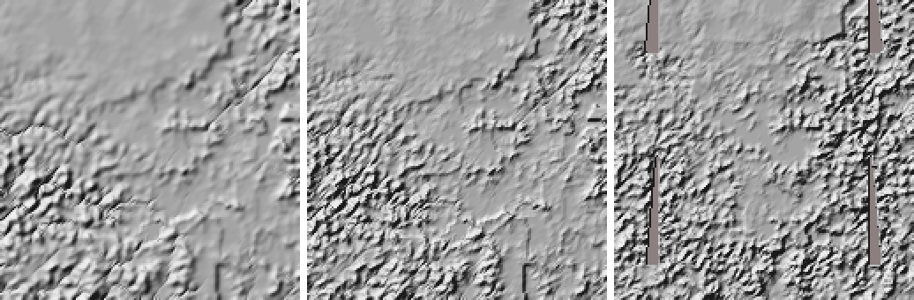
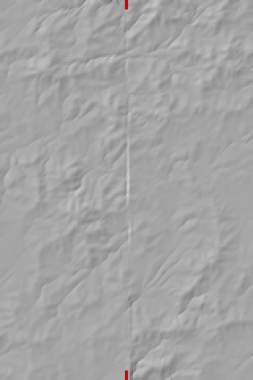

# PW-125: undesigned drops in the zoom (2026-10-15)

World 592f2a (showcase L7 seed 3199 @ 380 Myr), its 8 highlight zoom specs rebuilt with `zoom.build`
(3 at 4 km, 3 at 2 km, 2 at 1 km). A "drop" is a fall in `stats.falls` that isn't a designed lip, a
landform scarp/bench or a lake outlet. Each drop's cause is the stage where it first reaches 70% of its
final height (heights captured after the landscape pass, after creep and after the landform bedding:
`debug.stages` in the build's result).

## What changed

| Cause | Fix | Status |
|---|---|---|
| 2. Creep on 2-4 km pixels | Option C (owner, 2026-10-15): creep's per-step share scales as (2 km / res)^2 above 2 km (`zoom.creep_kd`); the ice's smoothing too, since it's the same operator. Creep's "stream" (whose bed it never lifts) is the drainage of 50 px *at 2 km* above 2 km, not 50 of the coarser pixels (800 km^2 at 4 km, where a 20-50 m^3/s stream was no channel and got lifted 100-470 m). | done |
| 1. Landscape pass, arcs | (a) The summit taper in `ZK.integrate` is integrated exactly along each link (closed form of dh/dx = s / (1 + (h - soft)/scale)^2) instead of being taken at the link's base. It was an Euler step that, on 4 km links with s ~200 m/km, climbed far past `soft` at full slope and then tapered the links above almost flat; the profile now doesn't depend on the pixel size. (b) `waterfalls()` now does what its docstring always said: a fall must be WF_CONTRAST x steeper than the river above *and* than the river below. The code pooled the two sides, so a flat side (the main river at a junction, a valley floor) halved the context, and a mountain stream as steep above as at its last link was listed as a fall. A hanging tributary (gentle above, a step at the floor) is still one. | partly: 69 -> 28 on the arc zoom; the 28 left are real concentrated steps from the slope-fit field (draft below) |
| 3. Landform bedding | The cell-mean correction after `lf.remap` goes on the hillslopes only, as after creep. On the channels too, with a weight of 3x the class weight, it lifted a bed where the classes weigh much (up to +590 m) over its foot two pixels on, where they weigh little. | done (7 -> 1 on the fold-belt zoom) |

The landform hypothesis in the ticket (`chan_` taken from the landscape pass's network rather than the remap's
drainage) was tested and is not the cause: the lips were channels on both, and switching the mask changed
nothing measurable. Left as it was.

## Drops >= 100 m, before and after

| Zoom | before (main) | after | after, by stage |
|---|---|---|---|
| 4.97,-114.51 (1000 km @ 2 km) | 0 | 0 | |
| 1.96,-70.44 (500 @ 1) | 13 (landscape 13) | 1 | landscape 1 |
| 4.81,-72.18 (500 @ 1) | 11 (landscape 4, landform 7) | 2 | landscape 1, landform 1 |
| 60.6,-40.48 (1000 @ 2) | 0 | 0 | |
| 49.32,37.38 (2000 @ 4) | 11 (creep 10, landscape 1) | 1 | landscape 1 (582 m) |
| -9.35,-161.39 (2000 @ 4, arc) | 79 (landscape 72, creep 6, landform 1) | 28 | landscape 28 |
| -2.22,-169.11 (1000 @ 2) | 0 | 0 | |
| -63.44,71.66 (2000 @ 4, arc) | 17 (creep 12, landscape 4, landform 1) | 1 | landform 1 |
| **total** | **131** (all drops >= 30 m: 174) | **33** (all: 53) | |

Step by step (totals >= 100 m): main 131 -> C 106 -> exact taper 100 -> per-side detector 45 -> landform
correction on hillslopes 38 -> creep's channel area at 2 km 33. The exact taper alone made 49.32,37.38
slightly worse (3 -> 5) and the arc better (75 -> 69); the next two fixes took those out.

Other kinds: designed lips unchanged (46 on the arc zoom, 45 before). The per-side detector also drops
reaches that were 3x the pooled context but not 3x each side: on the fold-belt zoom 4.81,-72.18, 10 of
40 listed falls, among them 7 `scarp` falls (30 -> 23). They were 17-69 m/km spread over 3-4 km of 1 km
pixels, either a steep stream onto a flat floor (above 10-34 m/km, below ~0) or the head of a steep reach
(above ~0, below 35-49 m/km). Those are steep reaches, not falls. `test_escarpment_rivers_fall_over_it`
and the other landform tests pass unchanged. Inland cell means are unchanged by C (49.32,37.38 bias +53
-> +50 m, RMS 159 -> 159; arc -10.6 -> -10.5, 163 -> 163; the +50 m offset is PW-298's).

## Is C right? A tiled reference

For three 4 km zooms (2000 km, 500 px): the mountain range 49.32,37.38, the arc -9.35,-161.39 and a
continental interior plain, 26.74,-49.92 (~650 m, 500 mm/yr, ~1900 km from the sea). Their middle was tiled
with 3x3 zooms at 1 km (500 km each, 16 km overlap, ~1470 km square) and 2x2 at 2 km (1000 km each).
The tiles' pixels, except their 8 px edge bands, were binned onto the 4 km zoom's grid (block averages
in the 4 km projection), and the statistics were taken over the land pixels covered by all of them
(103-129 k px). Columns: mean |5-point Laplacian| (m), median / p99 of pixel-to-pixel steps (m), mean 3x3
local relief (m), median height (m).

| Site | | lap | step p50 | step p99 | relief 3x3 | h p50 |
|---|---|---|---|---|---|---|
| range | 4 km, fixed share (before C) | 145 | 40 | 560 | 311 | 3443 |
| | **4 km, C** | **295** | **63** | **821** | **435** | 3434 |
| | 1 km tiles -> 4 km | 300 | 72 | 756 | 489 | 3392 |
| | 2 km tiles -> 4 km | 220 | 58 | 674 | 417 | 3428 |
| arc | 4 km, fixed share | 389 | 96 | 1393 | 621 | 3052 |
| | **4 km, C** | **531** | **122** | **1439** | **732** | 3027 |
| | 1 km tiles -> 4 km | 421 | 130 | 860 | 664 | 2972 |
| | 2 km tiles -> 4 km | 362 | 116 | 908 | 638 | 3115 |
| interior | 4 km, fixed share | 20 | 6.3 | 63 | 36 | 706 |
| | **4 km, C** | **32** | **8.5** | **78** | **45** | 705 |
| | 1 km tiles -> 4 km | 69 | 16.8 | 200 | 105 | 681 |
| | 2 km tiles -> 4 km | 41 | 10.4 | 162 | 69 | 686 |

*The range site's middle 680 km (hillshade x10): 4 km with the fixed creep share | 4 km with C | the 1 km
tiles averaged to 4 km (grey wedges: gaps between the tiles).*

**Verdict: C moves every 4 km zoom toward the averaged finer terrain, and it is right.** On the range it
lands on the 1 km reference (Laplacian 295 vs 300, median step 63 vs 72, relief 435 vs 489; the p99 step
overshoots, 821 vs 756). On the interior it closes half the gap and stays smoother (32 vs 41-69). On the
arc it overshoots: Laplacian 531 vs 421 (1 km) and 362 (2 km), +26% / +47%; p99 step 1439 vs 860-908. The
overshoot was there before C: the fixed-share 4 km arc already had a p99 step of 1393 m, 1.6x the
reference. Its sound reason is cause 1's remainder. On the arc the slope-fit field C rises 3-5x within
~12 km toward the pinned low river courses, so tributaries' last links are 100-250 m/km walls, 400-1000 m
high on 4 km links. The stronger creep was smearing them. Hypsometry is unchanged by C (median within
10 m) and agrees with the references to within 2-5%.

**Below 2 km the same physics says the fine zooms are under-crept.** The 2 km zoom is smoother than the
1 km tiles averaged to 2 km (range Laplacian 98 vs 176, interior 30 vs 40). The difference is the creep:
a 2 km zoom crept at the 1 km zooms' diffusivity (kd / 4) gives 238 / 45, near the 1 km tiles. And 1 km
tiles crept at the 2 km diffusivity (24 steps of kd 0.25), averaged to 2 km, give 92 / 28, which matches the
2 km zoom. So with one diffusivity at every pixel size, zooms of the same place agree across resolutions.
The owner's decision limited C to res > 2 km, so finer zooms keep their share; the measured option is
in the inbox (draft-zoom-creep-below-2km.md). The 4 km zoom with C against the same-diffusivity 2 km
tiles is still +34% (range) and +47% (arc) in Laplacian, and -21% (interior). What remains is the
landscape pass's own pixel dependence (stream power per pixel, the C fit), not creep.

## Would stitched finer zooms stand in for one coarse zoom?

No, not as they stand. Adjacent tiles don't agree where they meet. In the 16 km overlaps the two tiles'
heights differ by a median 183 m (range), 212 m (arc) and 53 m (interior). In a mosaic cut at the
mid-lines, the pixel step across a cut has a median of 222 / 285 / 58 m, against 29 / 55 / 6 m anywhere
else: about 10x. Only the noise is planet-fixed. The landscape pass (drainage, the C fit, the pinned
coarse rivers) is solved per zoom, with each zoom's edge pixels held at the coarse target surface
(`WF_EDGE_PX` = 8). Inside that band the 3x3 relief is twice the interior (405 vs 207 m on the range,
89 vs 47 m on the plain), so every tile has a rim. Coarse rivers cross the cuts (they come from the world). Of the zoom's own
streams >= 10 m^3/s that reach a cut, 29% (range), 45% (arc) and 0 of 3 (interior) continue within 2 px
across it; ridges likewise end at the cut. Cost: a 1 km tile takes 4.7-5.7 s and a 4 km zoom 7.4-8.5 s, so
covering one 2000 km zoom takes 16 tiles at 1 km (~85 s, ~10x, 16x the pixels) or 4 at 2 km (~24 s, ~3x).
A tiled view would need zooms that solve the drainage across their neighbours, or a nested zoom refining
one coarse zoom (PW-129) rather than independent tiles. Averaged to 4 km, the tiles are still the best
reference for what a 4 km zoom should look like (above).

*Two adjacent 1 km tiles on the interior plain (160 x 240 km, shown at 2x, hillshade x4), cut at their
mid-line (red ticks): a straight seam. On the range (`pw125_seam_range.png`) the coarse rivers continue
across while the relief changes texture at the cut.*

## Tests
- `tests/test_zoom_scale.py`: creep's share falls as (2 km/res)^2 above 2 km. A 40 km Gaussian hill
  loses the same height to a creep step at 2 and 4 km, where a fixed share lost >3.5x as much at 4 km.
  The summit taper's profile is the same on 1, 2 and 4 km links and matches the closed form; this
  fails on the old Euler step.
- `test_steep_stream_reaching_a_flat_floor_is_not_a_fall` (test_zoom_water.py): a 50 m/km stream whose
  last 4 km link drops 400 m onto a flat floor is not a fall (the pooled detector listed it); the same
  step below a gentle hanging valley is.
- `test_landform_mean_correction_spares_the_channels` (test_zoom_landforms.py).
- No existing test's expectation changed; goldens unchanged (they don't build zooms).

## Not done / left
- Cause 1's remainder: 28 drops >= 100 m on the arc zoom (up to 803 m), 1 on the range, 1 on each
  1 km zoom. Draft `draft-zoom-c-fit-steep-links-at-pinned-courses.md` (relates PW-298, which owns the C fit).
- Creep below 2 km: `draft-zoom-creep-below-2km.md` (needs-decision).
- The edge band: `draft-zoom-edge-band-relief.md`.
- Not re-checked from the ticket: hanging joins on reaches with designed falls at 4 km (the previous
  diagnosis found none on these 8 zooms), and `_escarpment_world(1.2, 400)`'s ~0.1 m cascades.
