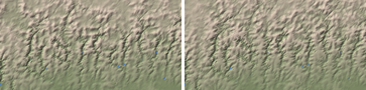

# PW-298 (with PW-319): the landscape pass's slope fit (2026-10-16)

World 592f2a (showcase L7 seed 3199 @ 380 Myr), its 8 highlight zooms (3 at 4 km, 3 at 2 km, 2 at 1 km)
plus the glaciated high plateau -48.48, 60.12 (2000 km at 4 km), each built with zoom seeds 1-5 (the
seed moves the noise and, since PW-339, the planet-fixed tie-breaks). "Drops" are `stats.falls` of kind
`drop` >= 100 m; "inland" is the cells away from the coast (`stats.inland_cell_mean_*`).

## What was wrong

The landscape pass grades every pixel above its receiver at slope = C / K x Q^-0.5 and fits C so the
land keeps the coarse cells' means. The fit was per pixel: C *= (box mean of the target / box mean of h)^0.8
over ~20 km boxes, 15 times. A pixel's height is the sum of the slopes all the way down to the sea or to a
held river course, but the update treated it as the pixel's own: next to a low, held course a box could
never reach its mean, C wound up (x1.5 a pass, to ~30,000), and the tributaries' last links beside the
course became 400-1000 m walls (PW-319). Elsewhere the coupled boxes settled 100-200 m off.

## The fit now

C is a smooth field at the coarse cells' scale (`zoom.fit_c` inside `build`). Each pass, per coarse
cell, a Newton step for h = base + C r: the factor that brings the cell's active land mean to the
target's, assuming the relief **its own slopes make** scales with C. That relief is h above where each
pixel's profile starts inside the cell (`zoom_kernels.local_base`): where its water leaves the cell, or a
held point on the way (an outlet, a river's floor, a capped summit), which doesn't respond to C. What lies
below that the cells downstream make and fit for themselves, so the steps don't double-count. The step is
at most x4 a pass and spread over the pixels with a Gaussian of 0.35 cells (`FIT_STEP`, `FIT_SIGMA`; the
kernel weights computed once, `gauss_weights` / `weighted_mean`, ~0.1 s for the 14 updates on a 4 km zoom).
C stays a regional quantity (uplift over erodibility), with no pixel-scale spikes, and since a held pixel
isn't asked to respond, nothing winds up.

Tried and dropped (arc zoom, seed 1): the Newton step on each pixel's whole height above its held base
(not the cell's own part): it oscillated and drifted, a cell rising while its own C rose because the cells
downstream fell (inland RMS 142 m); steps of x2 or a clip schedule (x4 for 5-6 passes, then x1.25-1.5):
slower, RMS 90-100 m on the arc and the range; a Gaussian of 0.5 cells: neighbours' steps cancel a cell's
own (RMS 60-90 m).

## The falls detector

21 of the arc zoom's 26 remaining drops (after the fit) were tributaries joining a designed fall's river
within 3 px of its lip: `waterfalls()` exempted every reach within 3 px of a designed lip from its contrast
test, meant for the designed river itself, so a steep stream entering the river just below the lip was
listed (and then labelled `drop`; or `lip` when it was the strongest fall near one: 3 such on the arc).
They were only ~1.25x as steep at their last link as above it. The exemption now holds only on the
designed river (a reach carrying >= 30% of the lip's water, `WF_DESIGNED_SHARE`); a tributary there is
tested like any other, so a hanging one is still a fall.

## Numbers (mean over seeds 1-5)

| Zoom | drops: PW-339 | detector only | **both** | inland bias / RMS (m): before | **after** |
|---|---|---|---|---|---|
| 4.97,-114.51 (1000 @ 2) | 0 | 0 | 0 | -25 / 55 | -25 / 54 |
| 1.96,-70.44 (500 @ 1) | 3.4 | 2.6 | 0 | -13 / 114 | -27 / 87 |
| 4.81,-72.18 (500 @ 1) | 2.0 | 2.0 | 1.6 | +63 / 171 | -3 / 54 |
| 60.6,-40.48 (1000 @ 2) | 0 | 0 | 0 | -2 / 18 | -2 / 8 |
| 49.32,37.38 (2000 @ 4) | 1.6 | 1.6 | 1.0 | +37 / 149 | +2 / 53 |
| -9.35,-161.39 (2000 @ 4, arc) | 28.8 | 17.2 | 3.4 | -1 / 149 | -6 / 58 |
| -2.22,-169.11 (1000 @ 2) | 0 | 0 | 0.2 | +8 / 78 | +1 / 42 |
| -63.44,71.66 (2000 @ 4, arc) | 3.0 | 3.0 | 3.0 | +6 / 58 | -1 / 24 |
| **8 zooms, total** | **38.8** (32-49) | **26.4** (21-35) | **9.2** (4-12) | | |
| -48.48,60.12 (glaciated plateau) | 1.0 | 1.2 | 0.6 | +8 / 35 | +2 / 14 |

- The arc zoom's p99 pixel-to-pixel step on land: 1290 -> 1164 m (the tiled 1 km reference averaged to
  4 km: 860 m, pw125.md). Designed lips: 46 -> 43 listed on the arc, the 3 being tributaries that took the
  label (above); the designed falls themselves are unchanged.
- The fit's residual (sum over cells of |mean error| x pixels) falls ~30-60x over the 15 passes; the
  largest C ends at 280-5,600 (arcs), steady over the last passes.
- The two zooms still ~25 m low (4.97,-114.51 and 1.96,-70.44) are off before the landscape pass: their
  delta plains flatten land up to 800 m high to a few metres over a radius of up to ~300 km, interior
  cells included (stage by stage on 1.96,-70.44: after the detail's mean passes -2 / 28 m, after the delta
  plains -23 / 73 m; the landscape pass then keeps that, where the old fit's own error happened to offset
  part of it: -13 m). Inbox draft.
- The earlier figure for the glaciated plateau (+129 / 228 m, PW-298's description) was on older code;
  with the old fit on today's code it is +8 / 35 m.
- On the test massif of `test_zoom_ice` (6 iterations) the old fit left the land 1450 m below its cells'
  means (RMS 1830 m); now +51 / 153 m. Its glaciers are now 18x bigger, and one 3 km^3/yr tongue reaches
  ~870 m (0.3% of the ice on ground with summers above 12 C); the test allows that share now (inbox draft
  on the tongue's snout).

*The arc zoom (-9.35,-161.39, 4 km; 720 x 360 km shown, hillshade x3), old fit | new: tributaries no
longer end in one-link walls at the held courses; the relief between the valleys is a little more even.*

## Tests
- `test_slope_fit_keeps_the_cell_means_and_settles` (escarpment world, 600 km at 2 km): residual falls
  >10x, C steady, inland bias / RMS 2 / 24 m (old fit: -88 / 95 m).
- `test_local_base_starts_each_profile_in_its_own_cell`; `test_tributary_near_a_designed_lip_is_tested_like_any_other`.
