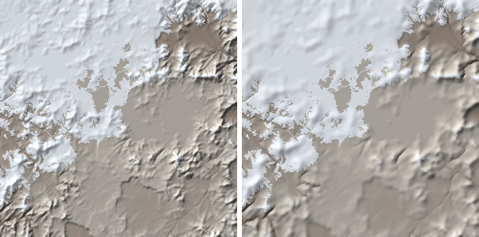
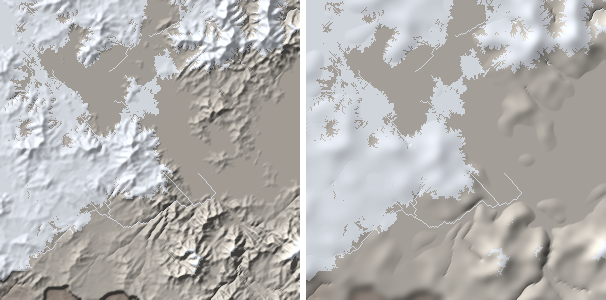
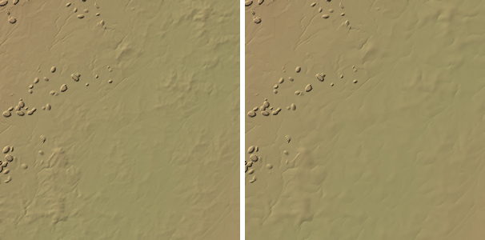
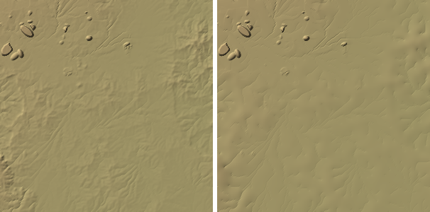

# PW-320: creep below 2 km, current vs option A (2026-10-16)

For the owner's decision. **Option A** (one creep diffusivity at every pixel size: below 2 km, more steps
of at most KD 0.25, so 1 km zooms creep 24 steps and 0.5 km zooms 96, where they now creep 6) is on the
local branch `pw320-option-a` (one commit on top of this batch: `zoom.creep_kd` returns the share and the
number of steps; `tests/test_zoom_scale.py` updated, its tests pass). Nothing of it is merged here.
Measured on world 592f2a with the PW-321 halo in both.

## Zooms of one place at three resolutions

Each site as a 1000 km zoom at 2 km (unchanged by A: A only differs below 2 km), the same 1000 km at
1 km, and the middle 500 km at 0.5 km; the finer ones block-averaged to 2 km pixels and compared on the
land pixels of both, 8 px edge bands left out. Columns: mean |5-point Laplacian| (m), median / p99
pixel-to-pixel step (m), mean 3x3 local relief (m).

| Site | | lap | step p50 | step p99 | relief 3x3 |
|---|---|---|---|---|---|
| range 49.32,37.38 | 2 km zoom | 103 | 40 | 433 | 281 |
| | 1 km -> 2 km, current | 161 | 52 | 483 | 336 |
| | 1 km -> 2 km, **A** | **82** | **38** | **365** | **260** |
| | 2 km zoom, middle 500 km | 69 | 31 | 322 | 205 |
| | 0.5 km -> 2 km, current | 183 | 52 | 476 | 311 |
| | 0.5 km -> 2 km, **A** | **67** | **35** | **286** | **217** |
| plain 26.74,-49.92 | 2 km zoom | 25 | 5.1 | 115 | 44 |
| | 1 km -> 2 km, current | 31 | 7.2 | 137 | 54 |
| | 1 km -> 2 km, **A** | **23** | **5.8** | **130** | **47** |
| | 2 km zoom, middle 500 km | 15 | 3.3 | 48 | 24 |
| | 0.5 km -> 2 km, current | 30 | 8.3 | 114 | 46 |
| | 0.5 km -> 2 km, **A** | **22** | **6.8** | **113** | **41** |

With A the finer zooms, averaged, land on the 2 km zoom (range: Laplacian 82 vs 103 at 1 km, 67 vs
69 at 0.5 km; today 161 and 183, 1.6x and 2.7x). On the plain they close most of the gap (23 vs 25, 22
vs 15; now 31 and 30). Hypsometry is unchanged (median heights within 30 m). So with A, zooming in shows
the same land at the coarser zoom's scale; today a finer zoom is a rougher landscape.

## What it looks like

The middle 300 px of a 500 km zoom at 1 km and a 250 km zoom at 0.5 km; current left, A right.

*Range, 1 km (300 km shown, hillshade x4): A rounds the ridges a little; the drainage pattern is kept.*

*Range, 0.5 km (150 km shown, hillshade x4): the big difference. A's 96 steps (16x today's diffusivity
in km) smooth away the pixel-scale ridges and gullies; what is left are rounded hills a few km across.
That is what the 2 km zoom says the land looks like at that scale, but the 0.5 km zoom no longer shows
anything sharper than ~2-3 km.*

*Plain, 1 km (hillshade x6).*

*Plain, 0.5 km (hillshade x6): today's fine gully texture becomes broad swales.*

## Other checks

- Undesigned drops >= 100 m on the two 1 km showcase zooms: 2 / 1 now, 3 / 1 with A (within the
  run-to-run spread: these counts move by +-2 with the drainage's tie-break jitter alone).
- Cost: negligible (`diffuse` is ~ms per step at 500 px; a 0.5 km zoom built in ~4 s with A).
- The stream no-lift rule is applied at every step against the surface before creep, so more steps
  can't lift a bed above it (not separately measured).

## The decision

A is the same physics as option C above 2 km and makes the resolutions agree. Its cost is the look at
0.5 km: finer zooms get smoother, not more detailed, since nothing below the creep length adds relief
back (no sub-pixel noise survives 96 steps). If the owner wants 0.5 km zooms to keep a crisp texture,
B (keep as is) or A down to 1 km only (finer zooms keep the 1 km zoom's 24 steps of KD: in km a
quarter of A's diffusivity, 4x today's) are the alternatives; the latter keeps 1 km zooms consistent with
2 km and makes 0.5 km zooms 4x smoother than now instead of 16x. Lean: A down to 1 km
(not built or measured here: a one-line change to `creep_kd` on the branch).
