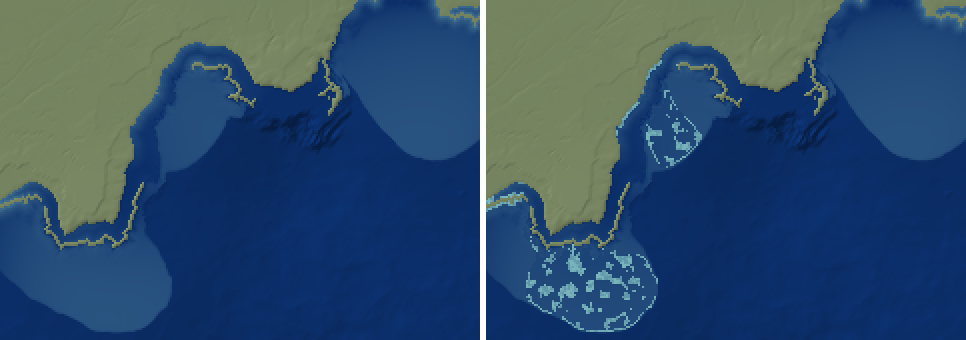
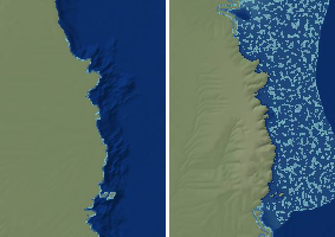

# PW-326: reefs as terrain in the zoom (2026-10-16)

Before: the zoom placed coral reef pixels (`coastal_life` = 1) as planet-fixed patches on warm, clear
floor above the reefs' light depth, but left the floor where it was (a reef at 20 m stayed at 20 m); only
the volcanoes' reefs (zoom_volcanoes) were landforms.

## Now (`zoom_coastal.place`, applied in `zoom.build`)
- **Where**, from the shelf's own geometry (the shelf: sea floor above the reefs' light depth; its width:
  the distance from the shore to the deep water beyond it, through the pixel):
  - a **fringing reef** along the shore of a shelf narrower than 15 km (`BARRIER_SHELF_KM`);
  - a **barrier reef** along the outer edge of a wider one, with the shelf behind it as its lagoon;
  - both 1 km wide (`REEF_BAND_KM`; at least a pixel, and on coarser pixels as many as the band's area
    fills), broken by passes (planet-fixed noise in ~8 km patches; 85% cover on a fully suitable coast);
  - **patch reefs** in between, as before (25% x the water's suitability), less the share the bands take
    of the shelf within 20 km, so the reefs keep the world's share.
- **Terrain**: every reef pixel's floor rises to a reef flat 1-3 m below the sea (`REEF_CREST_M`; the
  run's reefs build carbonate to -5 m, the crest higher), its fore-reef the pixel step; each coarse cell's
  mean kept by deepening the rest of its shelf (the lagoons; deeper floor at a tenth of the weight).
  The volcanoes' reefs keep their own terrain.
- Stats: `reef_forms` (km^2 of fringing, barrier and patch reef flats).

## Numbers
| | shelf 30 km (synthetic carbonate coast) | shelf 150 km | coral-coast zoom of 592f2a (1 km) |
|---|---|---|---|
| fringing / barrier / patch (km^2) | 644 / 0 / 0 | 320 / 400 / 11,008 | bands and patches: 1205 km^2 of reef (1065 before the bands; the world's cells: 600) |
| reef pixels' depth | 1-3 m | 1-3 m (was 16-18 m) | 1-3 m |
| the lagoon (non-reef shelf) median depth | | 23.6 m (was 17.1) | |
| cell means (all cells) | unchanged | unchanged (bias / RMS to 0.1 m) | +2.4 / 38.5 m, unchanged |

On the 8 showcase zooms of 592f2a (seeds 1-3) land, drops and cell means are unchanged; reef area grows
little, the bands mostly replacing patches (arc zoom, seed 1, 4 km: 15,700 km^2 of reef, of it 4,800
fringing, 160 barrier and 7,400 patch reef flats, the rest volcanic; 17,100 before).

*Coral-coast zoom (240 x 170 km, 2x), depth light (shallow) to dark blue (40 m+): with the shoreface only
| with reefs as terrain: barrier reefs along the edges of the two shelves, patch reefs in their lagoons,
fringing reefs along the shore.*

*A synthetic tropical carbonate coast (2 km px): a 30 km shelf with a fringing reef | a 150 km shelf with
dense patch reefs (the carbonate shelf is fully suitable) and a barrier reef along its edge (right).*

## Not done
- Patch reefs all reach the reef flat; real lagoons also hold submerged shoals (2-10 m) and the reef
  framework share (25%) is high for flats on a fully suitable shelf (GBR: ~9% of the shelf is reef).
  Left as the habitat model's share.
- Atoll-like reefs on isolated shallow banks away from volcanoes come out as a ring (a barrier with no
  shore), which is right; there is no reef growth limit from sea-level history.

## Tests
`tests/test_zoom_coastal.py::test_reefs_are_terrain_fringing_or_barrier`: reef pixels at 0.5-3 m; a
narrow shelf has a fringing reef and no barrier, a wide one a barrier; the lagoon deepens > 2 m; cell
means kept against the same zoom without the reef flats.
