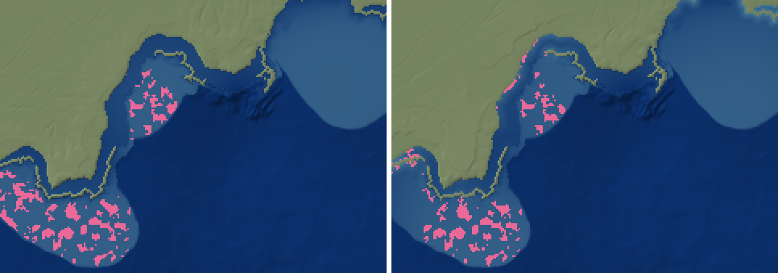

# PW-327: a shoreface in the zoom (2026-10-16)

## What was wrong
The zoom's sea floor is the coarse cells' depth interpolated, softly clamped below -0.5 m (a softplus 15 m
wide, so never shallower than ~11 m) and pulled to each sea cell's mean. Next to the shore it was *deeper*
than further out: on the coral-coast zoom of 592f2a (-12.35,-123.23, 500 km at 1 km) the median depth was
39 m within 1.5 km of the shore and 23 m at 10-20 km; no sea pixel was shallower than 10 m.

## The shoreface (`zoom_coastal.shoreface`, applied in `zoom.build` after the land is finished)
- Within the closure depth: Dean's equilibrium profile h = A x^(2/3), A = 0.1 m^(1/3) (fine sand, Dean
  1991): 6 m at 0.5 km, 10 m at 1 km, 21 m at 3 km; x from the shore (halfway to the nearest land pixel).
- Closure depth h_c = 6.75 x the mean significant wave height (Houston 1995), the height from the pixel's
  wave power (deep water, 8 s waves), within 3-25 m: ~11 m at 10 kW/m, ~5 m in a calm inland sea.
- Beyond it the inner shelf at 1.5 m/km, fading into the coarse floor over 6 km (at least 2 px): the
  coarse cells say where the shelf and the slope are; the zoom adds only what is below their scale.
- Only where the floor is deeper than that (it never deepens a shallower floor: prodeltas, tidal flats,
  lagoons stay); not on rocky coasts: the rockiness of the land along the coast nearby (land rising
  30-150 m within 3 km, or hard rock: the coastal-life rule, now `zoom_coastal.rocky_shore`), averaged
  along the coast, keeps deep water close in; not on the volcanoes' provinces (their reefs and lagoons).
- Each coarse cell's mean kept: what the shoreface raises is taken off the floor beyond its reach
  (`keep_means`).

## Numbers
| | before | after |
|---|---|---|
| coral coast, median depth 0-1.5 km / 1.5-3 / 3-6 km | 39 / 37 / 36 m | 15 / 21 / 29 m |
| coral coast, cell means (all cells) bias / RMS | +2.6 / 37.6 m | +2.4 / 38.5 m |
| coral coast, reef pixels (world's reef share of the region: 600 km^2) | 1151 km^2 | 1065 km^2 |
| synthetic low coast (60 m plain, 10 kW/m), median depth 1.5-3 km | 132 m | 17 m |
| 8 showcase zooms + plateau (seeds 1-3): drops, inland and all-cell means | | unchanged (land untouched; all-cell RMS within +-6 m) |

The beach highlight (-29.99,40.65) keeps its deep water: its coast is rocky by the rule. The ticket's own
region (run a1d3b9 @ 900 Myr, a finished world not kept) wasn't rebuilt; on 592f2a there are no flowering
plants yet, so seagrass couldn't be re-checked. With A = 0.1 the floor reaches 10 m at ~1 km, not ~5 km
as the ticket's checklist hoped: a sandy shoreface is that steep (the ticket's own example numbers);
flatter muddy and tidal shores (A ~ 0.05 or a convex mud profile) would need the coast type (PW-097).

*Coral-coast zoom (240 x 170 km shown, 2x), depth from light (shallow) to dark blue (60 m+), reef pixels
pink: before | after. The shore now has a light fringe of shallows; before, a darker trough lined it.*

## Tests
`tests/test_zoom_coastal.py`: Dean's numbers and the closure depth; a straight sandy coast shoals to
< 10 m within 1 km and deepens offshore, a rocky one is unchanged; a zoom of a low coast shoals from
~130 m to ~20 m at 1.5-3 km off the shore with its cell means kept.
